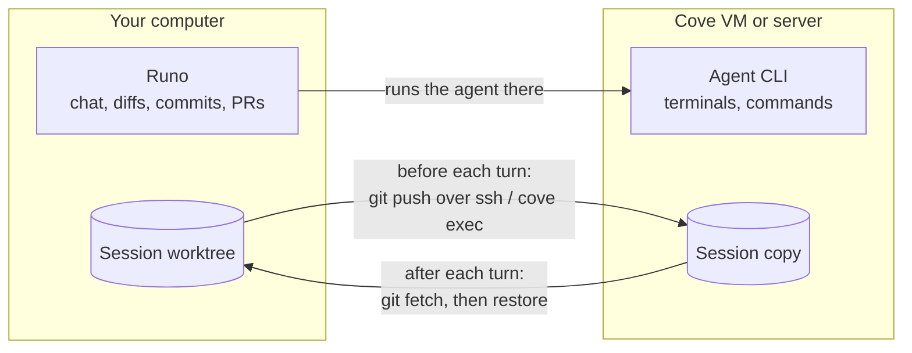

<div align="center">


# Runo

### Every coding agent. One native app.

Run Claude Code, Codex, Gemini, OpenCode, Cursor and more side by side,<br />
each in its own session and git worktree, with live output, diffs, a terminal,<br />
a browser and pull requests in one window. On your Mac, in a VM, or on your own server.

<br />

[](LICENSE)
[](native/runo-app)
[](https://github.com/deltalark/runo/releases)
[](#status)

**[Download](https://github.com/deltalark/runo/releases)** &nbsp;·&nbsp; [Quick start](#quick-start) &nbsp;·&nbsp; [Features](#features) &nbsp;·&nbsp; [Agents](#supported-agents) &nbsp;·&nbsp; [Run anywhere](#run-anywhere) &nbsp;·&nbsp; [Contributing](#contributing)

<br />


</div>

<br />

<table>
<tr>
<td width="33%" valign="top">

**⚡ Native and fast**<br />
Pure Rust. No Electron, no web view. Starts instantly and stays light with many agents running.

</td>
<td width="33%" valign="top">

**🔑 Bring your own agents**<br />
Runo drives the CLIs you already have installed and signed in. It never sells or proxies tokens.

</td>
<td width="33%" valign="top">

**🌿 Agents never collide**<br />
Each session can get its own git worktree and branch, so parallel agents never overwrite each other.

</td>
</tr>
<tr>
<td valign="top">

**🧩 Nothing hard-coded**<br />
Models, effort levels and permission modes are read from each CLI, so new releases show up without a Runo update.

</td>
<td valign="top">

**🛰️ Run anywhere**<br />
Start on your laptop, send a session to a VM or build server overnight, and pull it back. Files and conversation follow.

</td>
<td valign="top">

**✅ Review, then ship**<br />
Diffs, notes, commits, pushes and pull requests for every session, without leaving the app.

</td>
</tr>
</table>

## Quick start

**Download** a build for Apple silicon or Intel from [Releases](https://github.com/deltalark/runo/releases). Runo checks there for newer versions and offers to download them; nothing installs on its own.

**Or run from source:**

```bash
git clone https://github.com/deltalark/runo
cd runo
cargo run -p runo --release
```

You'll need macOS, a recent stable [Rust toolchain](https://rustup.rs), `git`, and at least one [agent CLI](#supported-agents) installed and signed in. The [GitHub CLI](https://cli.github.com) (`gh`) is optional, for pull requests, issues and Actions, as is a Chromium-based browser for the Browser tab.

<details>
<summary><b>Build Runo.app yourself</b></summary>

<br />

Use [cargo-bundle](https://github.com/burtonageo/cargo-bundle):

```bash
cargo install cargo-bundle
cd native/runo-app && cargo bundle --release
```

On Linux the same command makes a `.deb`, and on Windows the icon is built into `Runo.exe`. To publish a release, see [docs/releasing.md](docs/releasing.md). To change the icon, edit `native/runo-app/assets/icon/runo.svg` and run `python3 build.py` in that folder.

</details>

<details>
<summary><b>Where Runo keeps its data</b></summary>

<br />

Projects are stored in `~/.runo/state.json`, each session in its own file under `~/.runo/sessions`, and settings in `~/.runo/settings.json`. A log for each launch and any crash reports are in `~/.runo/logs`; after a crash, Runo offers to show or report it on the next start. Set `RUNO_HOME` to move them all.

</details>

## Features

### 🗂️ Sessions and worktrees


- **Projects and sessions.** Add any local folder and start sessions on it. The sidebar groups sessions by project, each with its own color, with live status dots, unread markers and `+/-` line counts.
- **Isolated worktrees.** A session can run in its own branch and folder under `.runo-worktrees/`, or right in your checkout. A setup command runs in each new worktree before the agent starts, and git-ignored files listed in `.worktreeinclude` (such as `.env`) are copied in.
- **Race several agents.** Send one task to several agents at once, each in its own worktree, compare the results and keep the best one.
- **Tabs and history.** Open sessions stay in tabs. Past Claude Code and Codex conversations on this machine are listed, and opening one resumes that exact conversation.

### 💬 Talking to agents

- **Live, structured output.** Each tool step (read, edit, run, search) streams in as it happens and folds into a tidy "Worked · N steps" summary.
- **A composer that knows the CLI.** Mention files with `@`, attach images, and pick model, effort and permission mode from options detected from the agent itself. Type your next message while the agent works and it's queued.
- **Approve from anywhere.** Permission requests, questions and plans from any session pop up in the corner, so you can answer without leaving what you're doing.
- **Undo, Keep or Review each turn.** Runo checkpoints the worktree before every turn, so a turn that went wrong rolls back in one click.
- **Context and limits.** `/compact` and `/clear`, fork from any turn, edit and resend a message. See tokens, cost and context per turn, and cap spending per session and per day.

<table>
<tr>
<td width="58%" valign="top">


**🔁 Switch agents mid-task.** Hand a session to another agent at any point. Runo shows exactly what carries over, what starts fresh and roughly what it costs. The new agent picks up in the same folder and branch. Switching back is free.

</td>
<td width="42%" valign="top">


**⌨️ Chat or the real CLI.** Every session has two views of one conversation: Runo's **Chat**, and the agent's own interactive **CLI**. Switch freely; nothing is resent to the model.

</td>
</tr>
</table>

### 🚢 Review and ship

- **Review page.** Every session whose agent stopped with changed files, in one list. Pick one to commit, push, open a pull request or merge.
- **Changes and diff notes.** Real `git` status and diffs with stage, discard, commit, push and **Create PR**. Click any diff line to leave a note, then send all notes back to the agent as one follow-up.
- **Files, Terminal and Browser.** Browse and edit the worktree with syntax highlighting, rendered Markdown, images and CSV. A real PTY shell with tabs and saved commands. A live page from a Chromium browser already on your Mac, with your dev servers one click away.
- **GitHub.** Pull requests, issues and Actions runs through the `gh` CLI, with one-click "review this PR" sessions.

### 🎨 Design and Architecture

Two canvases for the current project. **Design** draws screens, plays them as a clickable prototype, and lets AI design from your mockups and theme. **Architecture** draws diagrams of your system, with checks for what's missing, AI that explains or expands any part, and export to draw.io and Mermaid. A new project can start from either, before any code exists.

### 📒 Playbooks and automations


Save a task once and run it in any project: from the Playbooks page, Quick open, a project's right-click menu, or as a slash command inside the agent. Give it a schedule and Runo runs it on a timer. Templates cover finding bugs, scanning for vulnerabilities, updating docs, adding tests, reviewing changes and upgrading dependencies.

<details>
<summary><b>More on playbooks</b></summary>

<br />

- **Share them as files.** A playbook is a `.playbook.md` file: a short header (name, author, version, agent, permissions, inputs) and the instructions. Export one, paste it into a chat, or keep a folder of them in a git repo.
- **Install from anywhere.** Paste a GitHub repo, a link to one file, a local folder or the clipboard into **Install**. Runo lists what it found, marks new and updated playbooks, and shows what each one asks permission to do. **Update** checks the source again later.
- **Inputs.** Write `{{area}}` in the instructions and Runo asks for it before the run, with a default for scheduled runs.
- **Permissions.** A playbook says whether it may edit files, run commands or use the network, and Runo holds every turn to that in the way each agent allows: plan mode for read-only, turning off shell or web tools, Codex's sandbox without network. Where an agent can't be held to a limit, the run form says so.
- **Schedules.** Scheduled runs use the project's default connection and setup command, skip a run while the last one is still going, note runs missed while Runo was closed, and keep the last few sessions.
- **Agents can start playbooks**, and Runo asks you first (on by default).

</details>

### 🧠 Memory, MCP and setup

- **Project memory.** Runo ships a small MCP server that lets any agent read the session memory, search earlier sessions in the project and save notes, instead of pasting the whole history into every prompt.
- **Shared MCP servers.** Runo finds the MCP servers configured in every app on your computer, and you can share any of them with all agents. Servers you add in Settings → MCP reach every agent's sessions.
- **Hooks and skills.** See the Claude Code hooks and skills that apply to a project, open them in Runo's editor, and start a new skill.
- **Agents, installed for you.** See which agent CLIs are installed, install missing ones, sign in, and get a heads-up when an update is out. Per-agent defaults for model, path, arguments and environment.

### 🏠 Made to feel at home

<kbd>⌘K</kbd> Quick open for any session, file or command · light and dark themes with accent colors and an optional glass look · colorblind-friendly diffs · right-click menus everywhere · a one-minute tour on first launch.

## Supported agents

Runo detects each CLI on your `PATH` and shows its version in **Settings → Providers**.

| Agent | Command | | Agent | Command |
| --- | --- | --- | --- | --- |
| Claude Code | `claude` | | Copilot | `copilot` |
| Codex | `codex` | | Amp | `amp` |
| Gemini | `gemini` | | Droid | `droid` |
| OpenCode | `opencode` | | Qwen Code | `qwen` |
| Cursor | `cursor-agent` | | Grok | `grok` |

See [provider setup](docs/providers.md) for details.

## Run anywhere


A **connection** is a place a session can run besides your own machine. Add them in **Settings → Connections**, pick one under **Runs on** when you start a session (or make it a project's default), and move a session from its header whenever you like.

| Connection | What it is | Where the files are |
| --- | --- | --- |
| **This machine** | The agent runs directly on your computer. | Your worktree. |
| **Cove on this machine** | Each session gets its own Linux VM from [Cove](https://github.com/deltalark/cove). | Shared into the VM at the same path, so moving is instant. |
| **Cove server** | Cove on your VPS or a big box, by URL and API key. | A copy on the server, synced every turn. |
| **SSH server** | Any Linux or macOS machine you can `ssh` into. | A copy under `~/runo-work`, synced every turn. |



**Close your laptop, the agent keeps going.** On a Cove server or an SSH server the agent runs detached from your computer. Send a long task, close the lid, and when Runo opens again it picks the turn back up: finished work comes back right away, and a turn still running streams live.

<details>
<summary><b>How moving works</b></summary>

<br />

- **Everything travels.** Before each turn Runo commits the whole working tree, uncommitted and untracked files included, to a hidden ref and sends it over the connection itself. After the turn it brings the result back the same way. Commits the agent made come back on the branch; everything else comes back uncommitted, exactly as it was left.
- **The conversation travels too.** Claude Code's conversation files go along everywhere, and Codex's to SSH and Cove servers, so after a move the agent resumes the same conversation. Other agents get Runo's handoff brief.
- **Nobody's work is lost.** If files changed on both sides, your machine's version wins and the other is saved under `refs/runo/s<id>/kept-…`, with **Restore kept changes** in the chat.
- **What can't move.** Folders that aren't git repositories can only run on this machine or Cove on this machine.
- **Terminals open there.** A terminal tab in a remote session is a shell in that machine's copy. The CLI view and setup command run there too, and the Browser tab forwards that machine's dev servers to yours.
- **No GitHub access needed.** Syncing goes over `ssh` or `cove exec`, never through GitHub, so a VM never needs your credentials. Turn on **GitHub access** for a connection only if the agent there needs `gh`; the token is passed per command and never written to disk.
- **Backups (off by default).** After each turn the checkpoint can also be pushed to your `origin` as `refs/runo/sessions/<id>`, which no branch list shows. Public repositories are never backed up.

</details>

<details>
<summary><b>Detached runs, in detail</b></summary>

<br />

The agent runs as a Cove named process, or under `setsid nohup` over SSH. Its output goes to a log on that machine, and Runo follows the log.

- **Dropped connections** reconnect and carry on from the last line shown, while the agent keeps going.
- **Stop** ends the agent's processes there, then brings back what it did so far.
- **Your keys** reach that machine in a script only its owner can read, and the script deletes itself as soon as it starts.
- **Approvals.** Claude Code asks for permission mid-turn through Runo's MCP relay, and the turn waits while you answer: **Allow once**, **Always allow** or **Deny**. While Runo is closed, the request waits on the server until Runo reconnects or the wait in Settings → Chat runs out.
- **A turn that never starts**, because the machine rebooted first, ends after a few minutes with a message instead of waiting forever.

Runo stops keeping your computer awake while only remote turns are running. Cove on this machine pauses when your computer does; use a Cove server or an SSH server for work that should go on without it.

</details>

<details>
<summary><b>Agents can use connections too</b></summary>

<br />


Runo's MCP server works in every session, in Cove VMs and on servers too. Agents get `list_connections` and `run_on`, so they can run a heavy build, a test matrix or some research on another machine without moving the whole session. With **Let agents use Cove** on, agents can also make throwaway VMs for untrusted code. Each connection has an **Agents may use it** switch, and only the API keys you list for a connection ever reach it.

</details>

<details>
<summary><b>Setting up a connection</b></summary>

<br />

- **SSH:** add an SSH server and type a host from your `~/.ssh/config` (or `user@host`). Runo uses your SSH agent and config, shares one login between the agent, terminals and syncs, and never turns off host key checks. **Test** shows what it found: the OS, git and the agent CLIs.
- **Cove on this machine:** install Cove (see its [install guide](https://github.com/deltalark/cove#install)) and Runo offers a Cove VM under **Runs on** on its own. Set the VM's CPUs, memory, network and idle stop in Settings.
- **Cove on a server:** install Cove on the server, run `cove key` there, then add a Cove connection in Runo with the server's URL and that key.

Agent CLIs are installed on the connection on first use and kept at the version you run here. API keys listed for the connection are forwarded. Codex and Claude Code on Linux keep their login in a file, which Runo copies over; Claude Code on macOS keeps it in the keychain, so run `claude setup-token` and export `CLAUDE_CODE_OAUTH_TOKEN`, or set `ANTHROPIC_API_KEY`.

Deleting a session deletes its VM or its copies on every connection it ran on, and removing a connection cleans up what Runo left there.

</details>

## On your phone

The phone bridge serves a small API that a phone app can use to follow every session and answer it: allow or deny a permission request, approve a plan, answer an agent's questions, send a follow-up or stop a run. Turn it on in **Settings → Phone**, where each phone gets its own pairing code, or run `runo --phone`. It listens on your Tailscale address, or only on this computer without one. See [docs/phone-bridge.md](docs/phone-bridge.md). The mobile app itself is coming next.

## Status

Runo is early and moving quickly. Expect rough edges, and please [open an issue](https://github.com/deltalark/runo/issues) when you hit one.

## Contributing

Contributions are welcome. See [CONTRIBUTING.md](CONTRIBUTING.md) to get set up, and [SECURITY.md](SECURITY.md) to report a vulnerability privately. Changes are tracked in [CHANGELOG.md](CHANGELOG.md), and the user guide lives in [docs/guide](docs/guide).

<br />

<div align="center">

[MIT](LICENSE) · Made with Rust

</div>
