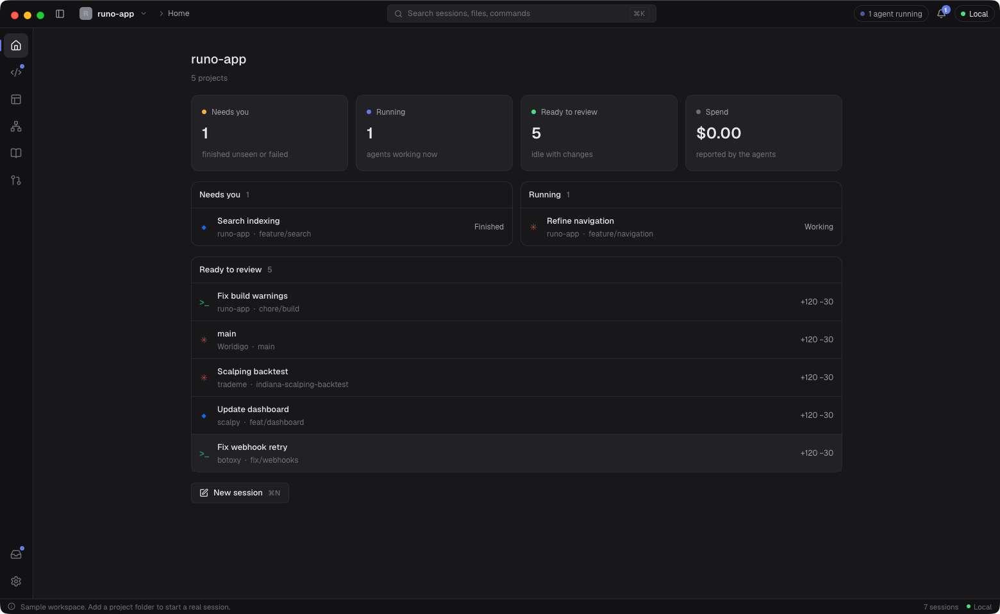
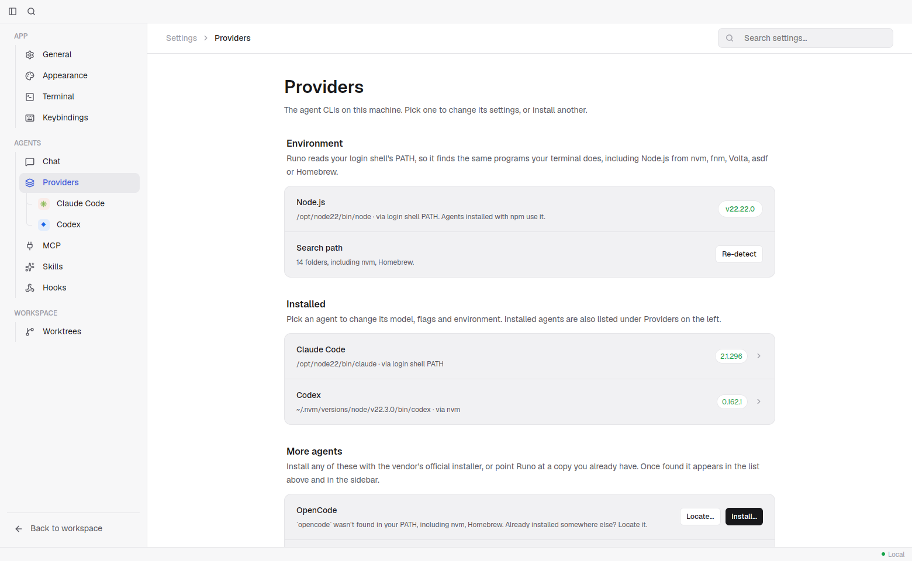
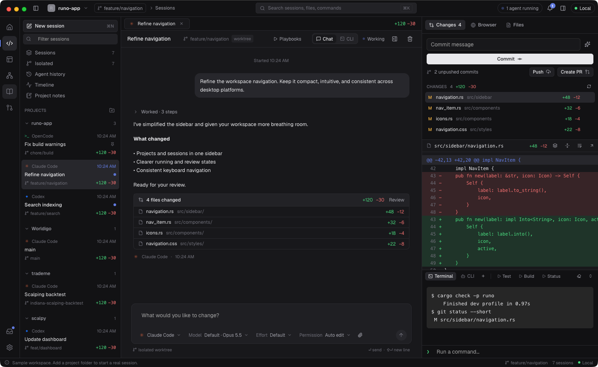
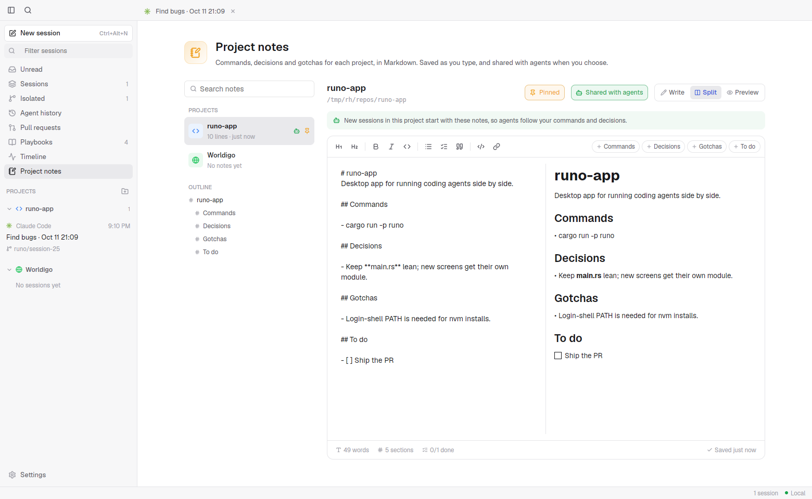
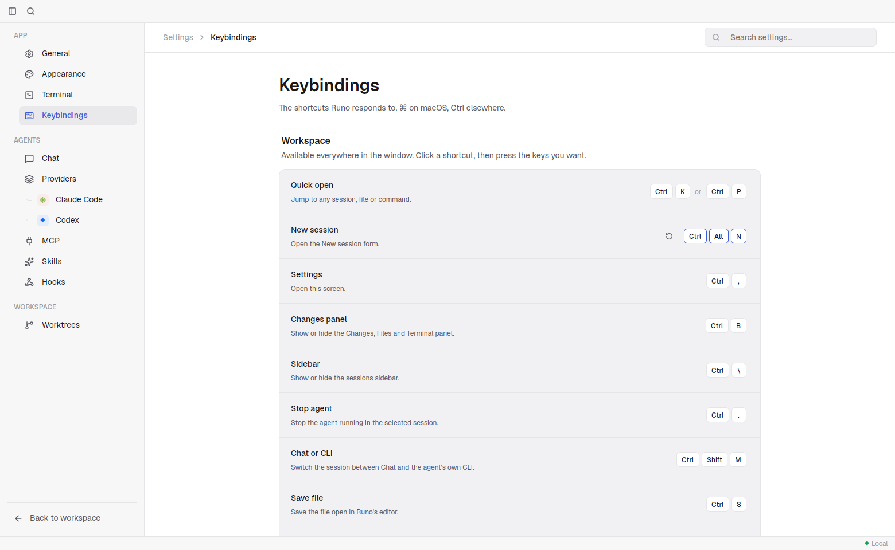
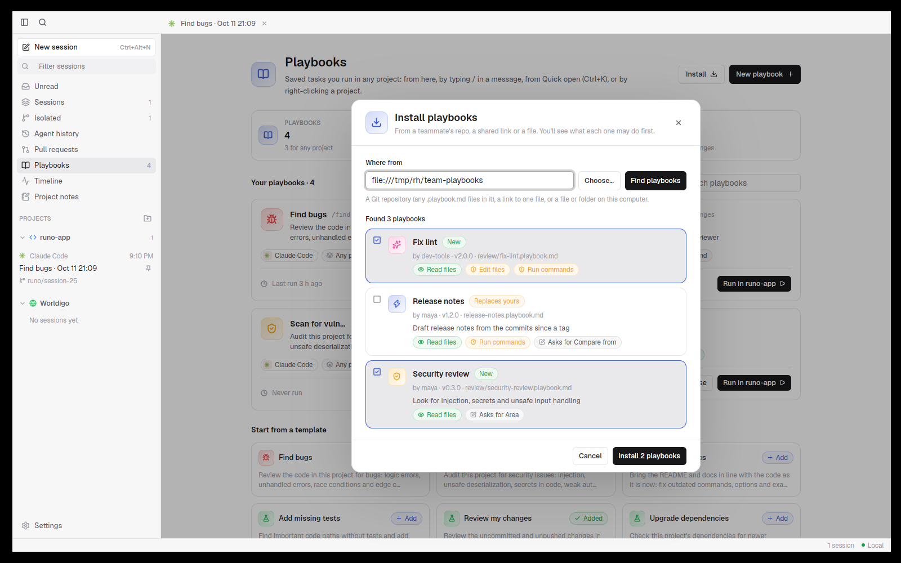
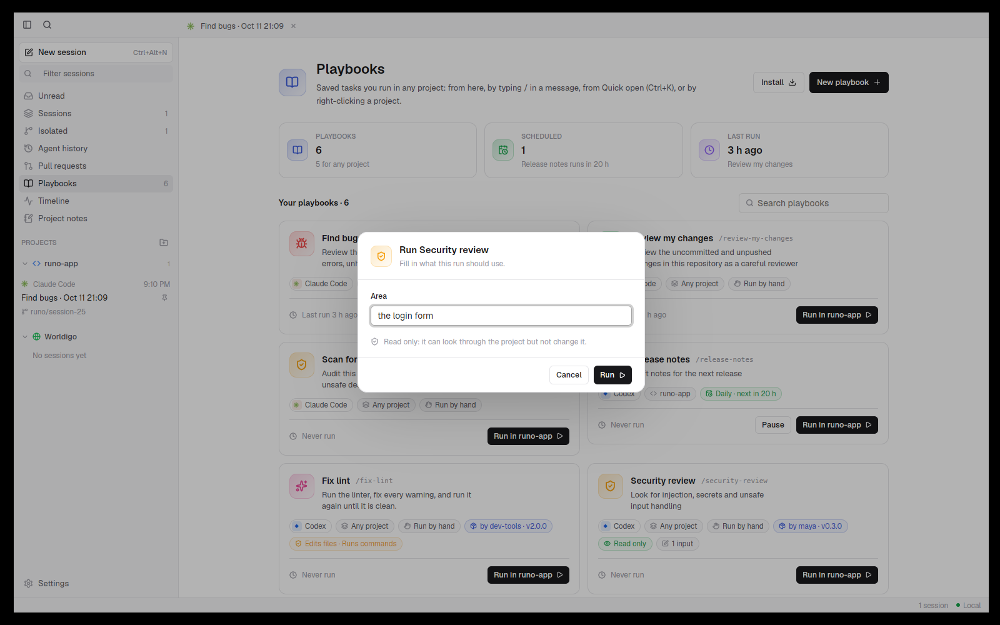
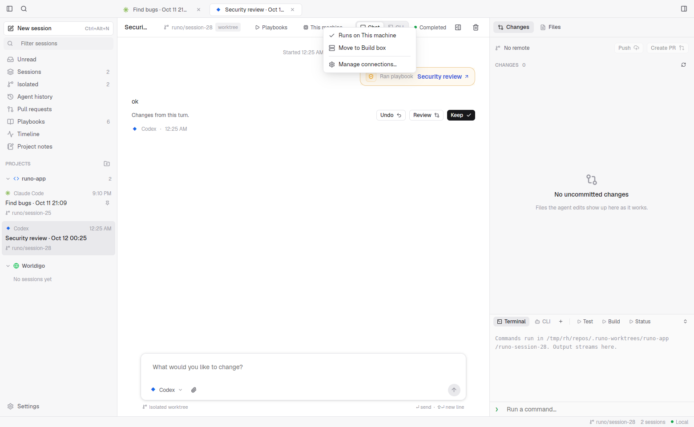
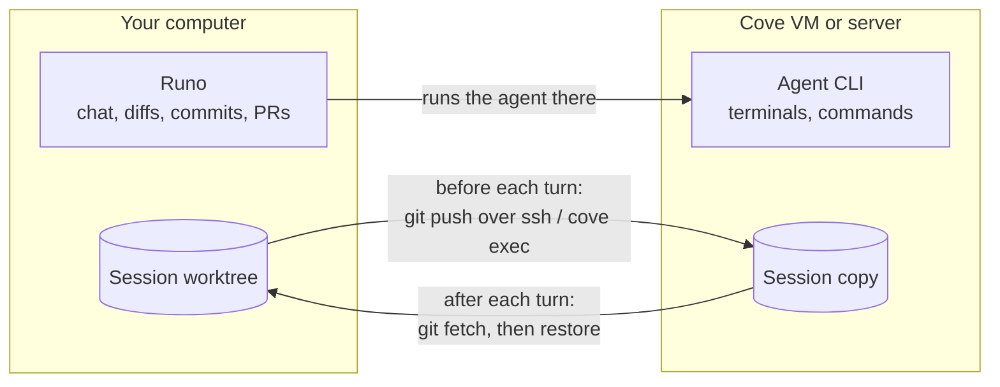
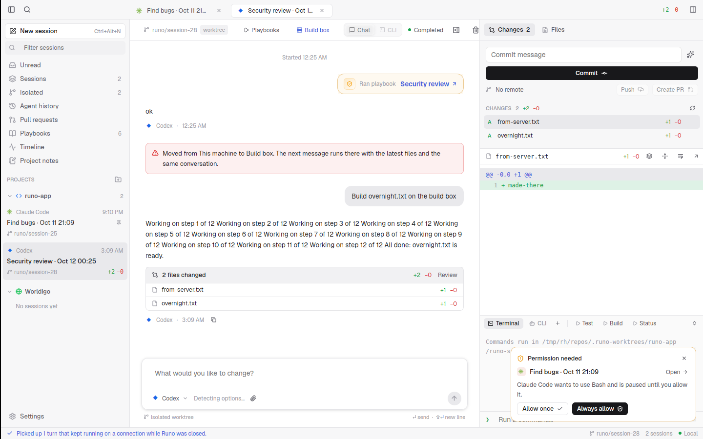

<div align="center">


# Runo

**Run every coding agent side by side, in one native app.**

Claude Code, Codex, Gemini, OpenCode, Cursor and more, each in its own session and its own git worktree,
with live output, diffs, a real terminal, a browser and pull requests in one window.
Run them on your machine, in a Cove VM or on your own server, move them between the three at any time,
and close your laptop while they keep working.

[](LICENSE)


[Install](#install) · [The Workbench](#the-workbench) · [Features](#features) · [Connections](#connections-run-anywhere) · [Playbooks](#playbooks-and-automations) · [Supported agents](#supported-agents) · [Contributing](#contributing)

<br />



</div>

## Why Runo

Coding agents are good at working on their own, but juggling several of them across terminal tabs gets messy fast. Runo gives each agent its own session and its own isolated copy of the code, then puts everything you need to steer and review them in one place.

- **Native and fast.** Written in pure Rust, with no Electron and no web view behind the interface. It starts instantly and stays light while many agents run.
- **Bring your own agents.** Runo drives the agent CLIs you already have installed and signed in. It never sells or proxies tokens.
- **Nothing hard-coded.** Models, effort levels, permission modes and other options are read from each installed CLI, so new releases show up without a Runo update.
- **Agents never collide.** Every session can get its own git worktree and branch, so parallel agents never overwrite each other's work.
- **Run anywhere, move any time.** Start a session on your laptop, send it to a VM or your build server, close the lid, and pull it back later. The files and the agent's conversation follow it.

## Install

### Requirements

- macOS (Linux and Windows builds are also targeted, but macOS is the primary platform today)
- A recent stable [Rust toolchain](https://rustup.rs) and `git`
- At least one agent CLI from [the table below](#supported-agents), installed and signed in
- Optional: the [GitHub CLI](https://cli.github.com) (`gh`) for pull requests, issues and Actions; Chrome, Edge, Brave or Chromium for the Browser tab; and [Cove](https://github.com/deltalark/cove) for VMs

### Build and install the app

Runo is built from source. [cargo-bundle](https://github.com/burtonageo/cargo-bundle) makes a proper `Runo.app` with its icon:

```bash
git clone https://github.com/deltalark/runo
cd runo
cargo install cargo-bundle
cd native/runo-app && cargo bundle --release
```

Then copy it into Applications, replacing any older copy:

```bash
rm -rf /Applications/Runo.app && cp -R ../../target/release/bundle/osx/Runo.app /Applications/
```

Open Runo from Launchpad, Spotlight or the Dock. On Linux the same `cargo bundle` command makes a `.deb`, and on Windows the icon is built into `Runo.exe`.

To update later, `git pull` in the checkout and run the two commands again. Your projects, sessions and settings are kept.

### Run from source

For development, run it straight from the checkout:

```bash
cargo run -p runo --release
```

### First launch

With no projects yet, Runo opens a demo workspace and a one-minute tour you can replay any time. Add a folder with **New session** and the demo goes away.

Runo finds your agents even when it starts from the Dock, where macOS hands apps a minimal `PATH`. It reads your login shell's `PATH` and also looks in the folders that nvm, fnm, Volta, asdf, mise, nodenv, Homebrew and the npm, pnpm, Bun and Yarn global installs use. **Settings > Providers** shows Node's version, where each agent was found and which folders were searched, with **Locate…** and **Re-detect** for anything it missed.



### Where Runo keeps its data

Projects and sessions are stored in `~/.runo/state.json` and settings in `~/.runo/settings.json`. Set `RUNO_HOME` to move them.

## The Workbench

Runo's window is a workbench with a place for each kind of work.

- **The mode rail** on the left switches between **Home**, **Sessions**, **Design**, **Architecture**, **Playbooks** and **Reviews**, with **Inbox** and **Settings** at the bottom. <kbd>⌘1</kbd> to <kbd>⌘6</kbd> jump straight to each mode.
- **The top bar** holds the project switcher, the current branch, a breadcrumb, <kbd>⌘K</kbd> search, how many agents are running, what they have spent in total, the inbox bell, and where agents run.
- **Home** sorts every session into what **needs you** (finished while you were away, or failed), what is **running**, and what is **ready to review** (idle with uncommitted changes). The top bar's counters use the same rules, so the two always agree.
- **Sessions** is where the work happens: the session list on the left, and open sessions in a tab strip over the session itself.
- **Reviews** gathers pull requests, issues and Actions runs, and **Inbox** lists the sessions with replies you haven't read yet.
- **Design** and **Architecture** have their places on the rail now. Each page describes what the mode will hold: designing an app's screens before agents build it, and keeping its architecture in the repo and checking each change against it.



## Features

### Sessions and worktrees


- **Projects and sessions.** Add any local folder and start sessions on it. Sessions are grouped by project, with live status dots, unread markers and `+/-` line counts.
- **Isolated worktrees.** A session can run in its own branch and folder under `.runo-worktrees/`, or right in your checkout. A setup command runs in each new worktree, and git-ignored files listed in `.worktreeinclude` (such as `.env`) are copied in.
- **Race several agents.** Send one task to several agents at once, each in its own worktree, compare the results and keep the best one.
- **Tabs and split view.** Open sessions stay in tabs, and any two sessions can sit side by side, each live with its own reply box.
- **Agent history.** Past Claude Code and Codex conversations on this machine are listed, and opening one resumes that exact conversation.
- **Tidy up.** Right-click a project to open its notes or remove it. Removing a project stops its sessions; deleting its worktrees or its folder each needs an explicit tick, and the folder needs its name typed.

### Talking to agents


- **Live, structured output.** Each tool step (read, edit, run, search) streams in as it happens and folds into a tidy "Worked · N steps" summary.
- **A composer that knows the CLI.** Mention files with `@`, attach images, and pick model, effort, permission mode and more from options detected from the agent itself. Type your next message while the agent works and it is queued.
- **Approve from anywhere.** Permission requests, questions and plans from any session pop up in the corner, so you can answer without leaving what you're doing.
- **Undo, Keep or Review each turn.** Runo checkpoints the worktree before every turn, so you can roll back a turn that went wrong with one click.
- **Usage at a glance.** Tokens, cost and context use per turn and per session, and total spend in the top bar.

### Switch agents mid-task


Hand a session to another agent at any point. Before anything happens, Runo shows exactly what carries over, what starts fresh and roughly what it costs. The outgoing agent writes a short recap, and the new agent picks up in the same folder and branch, with the same changed files. Switching back is free.

### Chat or the agent's own CLI


Every session has two views of the same conversation. **Chat** is Runo's own interface, and **CLI** runs the agent's real interactive CLI on the same conversation id. Switch between them freely; nothing is resent to the model.

### Review and ship

- **Changes.** Real `git` status and diffs for each session, with stage, discard, commit, push and **Create PR** buttons.
- **Diff notes.** Click any diff line, leave a note, and send all notes back to the agent as one follow-up.
- **Files.** Browse and edit the worktree, with syntax highlighting, rendered Markdown, images and CSV tables.
- **Terminal.** A real interactive shell (PTY) in the session's folder, with several tabs per session, your saved commands as one-click buttons, and the agent's own command output.
- **Browser.** A live, interactive page from a Chromium-based browser already on your Mac, embedded in the session. Before a page is open it lists the dev servers running on your machine.
- **GitHub.** Pull requests, issues and Actions runs for the project through the `gh` CLI, with one-click "review this PR" sessions.

### Project notes



Keep each project's commands, decisions and gotchas in Markdown, saved as you type. Write, Split and Preview views, a formatting toolbar, one-click sections, a clickable outline, search across projects and pinning make them quick to keep up. Turn on **Share with agents** and every new session in that project starts with the notes, so agents follow your commands and decisions without being told again.

### Memory and MCP

- **Session memory.** Runo ships a small MCP server that lets any agent read the session memory, search earlier sessions in the project and save notes, instead of having the whole history pasted into every prompt.
- **Shared MCP servers.** Runo finds the MCP servers configured in every app on your computer, and you can share any of them with all agents, not just the one it was set up for.
- **Hooks and skills.** See the Claude Code hooks and skills that apply to a project.

### Agent setup, built in

- **Install and update agents from Runo.** See which agent CLIs are installed and their versions, install missing ones, and get a heads-up when an update is out. Runo updates the exact copy it runs and tells you plainly when it shouldn't.
- **Per-agent settings.** Default model, executable path, extra arguments, environment variables and agent-specific options.

### Made to feel at home


- **Quick open** with <kbd>⌘K</kbd> to jump to any session, file, playbook or command.
- **Your own shortcuts.** In **Settings > Keybindings**, click a shortcut and press the new keys. Runo warns you when the keys are already taken, and you can reset one shortcut or all of them.
- **Light and dark themes**, accent colors, colorblind-friendly diff colors, and an optional glass look.
- **Right-click menus** everywhere: pin, rename, open beside, archive and more.



## Playbooks and automations


Save a task once and run it in any project: from the Playbooks page, from Quick open, by right-clicking a project, or by typing `/` in the composer. Give a playbook a schedule and Runo runs it on a timer while it is open. Templates cover finding bugs, scanning for vulnerabilities, updating docs, adding tests, reviewing changes and upgrading dependencies.

- **A page for all of them.** Each playbook gets a card with its agent, project, schedule, last run and a **Run** button, plus search and an editor for the agent, project and schedule.
- **Tidy in the chat.** A playbook picked with `/` becomes a chip in the composer. Its instructions are sent behind the scenes, and the chat shows a short "Ran playbook" line that links back to it.
- **Inputs.** Write `{{area}}` in the instructions and Runo asks for it before the run, with a default for scheduled runs.
- **Permissions.** A playbook says whether it may edit files, run commands or use the network. Read-only playbooks run in plan mode, so a review can't change your code.

### Share playbooks as files



A playbook is a `.playbook.md` file: a short header (name, author, version, agent, permissions, inputs) and the instructions. Export one, copy it into a chat, or keep a folder of them in a git repo.

To install, paste a GitHub repo, a link to one file, a local folder or the clipboard into **Install**. Runo lists what it found, marks new and updated playbooks, and shows what each one asks permission to do before you install it. **Update** checks the source again later.



## Connections: run anywhere


A **connection** is a place a session can run besides your own machine. Add them in **Settings > Connections**, pick one under **Runs on** when you start a session (or make it a project's default), and move a session from its header whenever you like.

| Connection | What it is | Where the files are |
| --- | --- | --- |
| **This machine** | The agent runs directly on your computer. | Your worktree. |
| **Cove on this machine** | Each session gets its own Linux VM from [Cove](https://github.com/deltalark/cove). | Shared into the VM at the same path, so moving is instant. |
| **Cove server** | Cove on your VPS or a big box, by URL and API key. | A copy on the server, synced every turn. |
| **SSH server** | Any Linux or macOS machine you can `ssh` into. | A copy under `~/runo-work`, synced every turn. |



### How moving works



- **Everything travels.** Before each agent turn Runo commits the whole working tree, uncommitted and untracked files included, to a hidden ref and sends it over the connection itself. After the turn it brings the result back the same way. Commits the agent made come back on the branch; everything else comes back uncommitted, exactly as it was left.
- **The conversation travels too.** Claude Code's conversation files go along everywhere, and Codex's to SSH and Cove servers, so after a move the agent resumes the same conversation instead of starting over. Other agents get Runo's handoff brief.
- **Nobody's work is lost.** If files changed on both sides, your machine's version wins and the other is saved under `refs/runo/s<id>/kept-…`, ready to diff or restore.
- **Terminals open there.** A terminal tab in a remote session is a shell in the session's copy on that machine, synced before it opens and after it closes.
- **No GitHub access needed.** Syncing goes over `ssh` or `cove exec`, never through GitHub, so a VM never needs your credentials. Your machine keeps doing the commits, pushes and pull requests. Turn on **GitHub access** for a connection only if the agent there needs `gh` for its own work; the token is passed per command and never written to disk.
- **Backups.** After each turn the checkpoint is also pushed to your project's `origin` as `refs/runo/sessions/<id>`, which no branch list shows. Turn it off in Settings.

### Close your laptop, the agent keeps going



On a Cove server or an SSH server, the agent runs **detached** from your computer: as a Cove named process, or under `setsid nohup` over SSH. Its output goes to a log on that machine, and Runo follows the log. So you can send a long task, close the lid or shut down, and come back later:

- **While you're away** the agent keeps working there, and its files stay in the session's copy on that machine.
- **When Runo opens again** it picks the turn back up. The reply replays from the start, and if the turn already finished, its work and conversation come back right away. If it's still running, you watch the rest live.
- **Dropped connections** are handled the same way: Runo reconnects and carries on from the last line it showed, while the agent keeps going.
- **Stop** still stops it: Runo ends the agent's processes there, then brings back what it did so far.
- **Your keys** reach that machine in a script only its owner can read, and the script deletes itself as soon as it starts.

Runo also stops keeping your computer awake while only remote turns are running. Cove on this machine runs alongside your computer, so it pauses when the computer does; use a Cove server or an SSH server for work that should go on without it.

### Agents can use connections too


Through Runo's MCP server, agents get `list_connections` and `run_on`, so they can run a heavy build, a test matrix or some research on another machine without moving the whole session. With **Let agents use Cove** on, agents on your machine also get Cove's own tools and can make throwaway VMs for untrusted code. Each connection has an **Agents may use it** switch, and only the API keys you list for a connection ever reach it.

### Setting one up

- **SSH:** add an SSH server and type a host from your `~/.ssh/config` (or `user@host`). Runo uses your SSH agent and config, shares one login between the agent, terminals and syncs, and never turns off host key checks. **Test** shows what it found: the OS, git and the agent CLIs.
- **Cove on this machine:** install Cove with its [one-line installer](https://github.com/deltalark/cove#install) and Runo offers a Cove VM under **Runs on** on its own. Set the VM's CPUs, memory, network (on or off) and idle stop in Settings.
- **Cove on a server:** install Cove on the server with the same one-liner, run `cove key` there, then add a Cove connection in Runo with the server's URL and that key.

Agent CLIs are installed on the connection on first use, and deleting a session deletes its VM or its copy on the server.

## Supported agents

Runo detects each CLI and shows its version and location in **Settings > Providers**.

| Agent | Command | | Agent | Command |
| --- | --- | --- | --- | --- |
| Claude Code | `claude` | | Copilot | `copilot` |
| Codex | `codex` | | Amp | `amp` |
| Gemini | `gemini` | | Droid | `droid` |
| OpenCode | `opencode` | | Qwen Code | `qwen` |
| Cursor | `cursor-agent` | | Grok | `grok` |

See [provider setup](docs/providers.md) for details.

## Status

Runo is early and moving quickly. Expect rough edges, and please [open an issue](https://github.com/deltalark/runo/issues) when you hit one.

## Contributing

Contributions are welcome. See [CONTRIBUTING.md](CONTRIBUTING.md) to get set up, and [SECURITY.md](SECURITY.md) to report a vulnerability privately. Changes are tracked in [CHANGELOG.md](CHANGELOG.md).

## License

[MIT](LICENSE)
