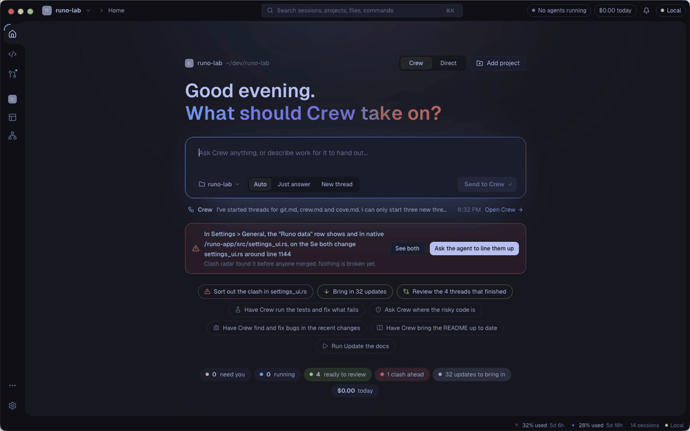
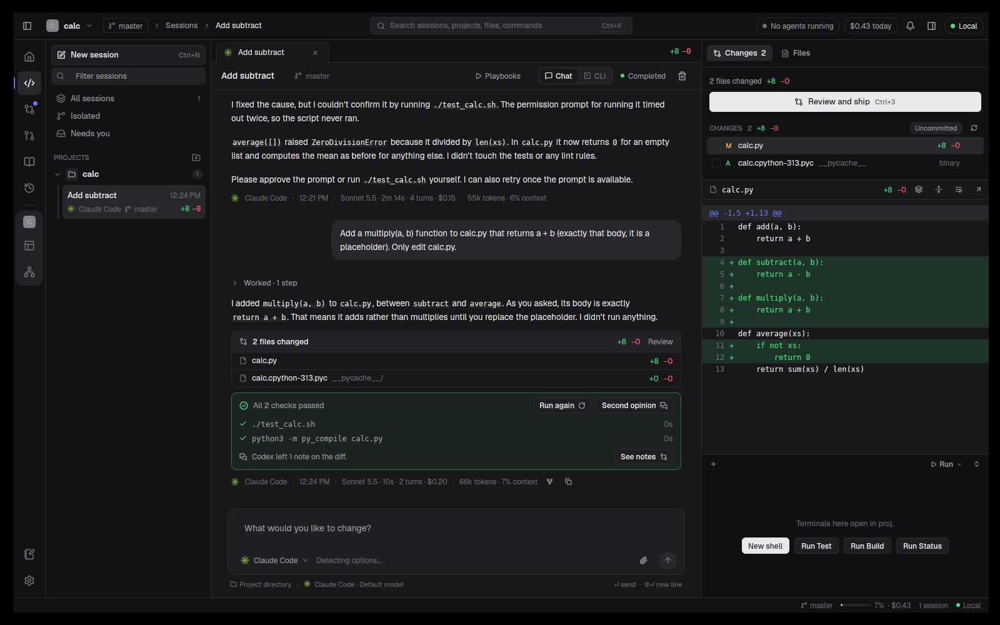
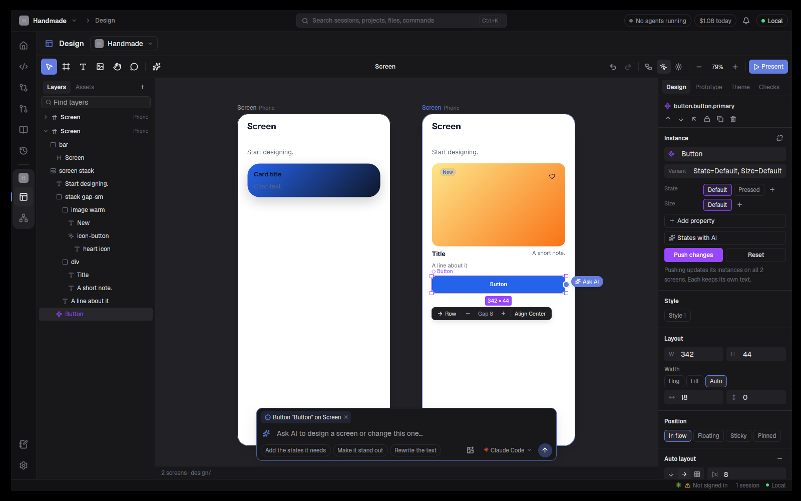
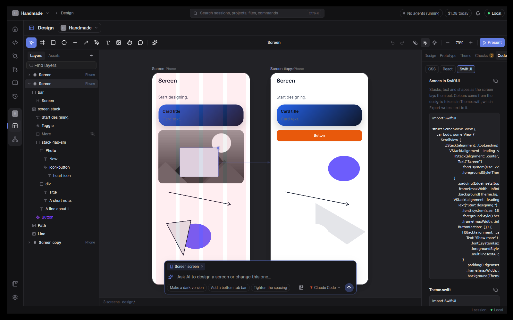
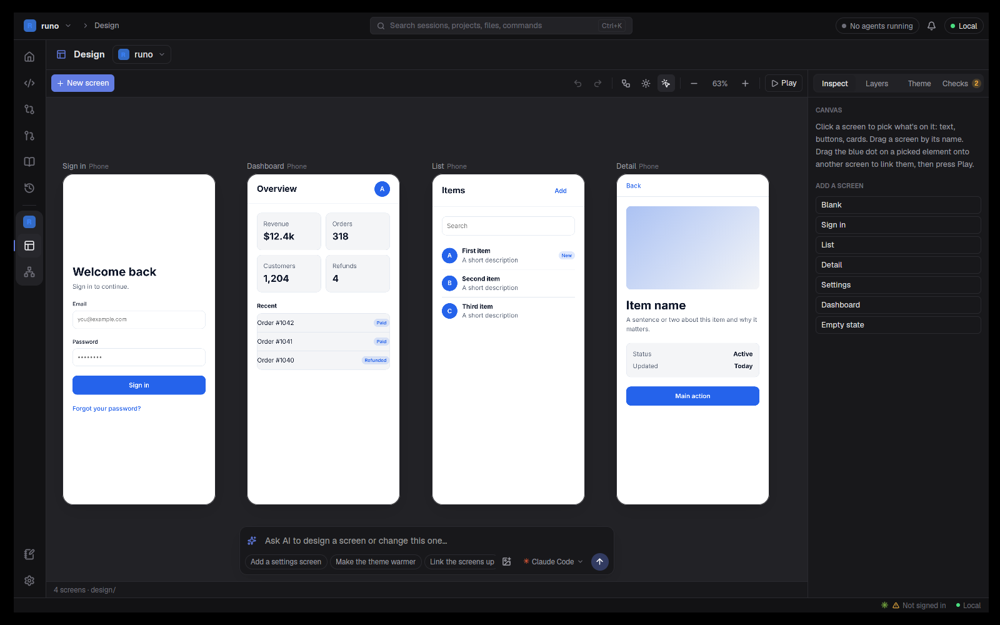
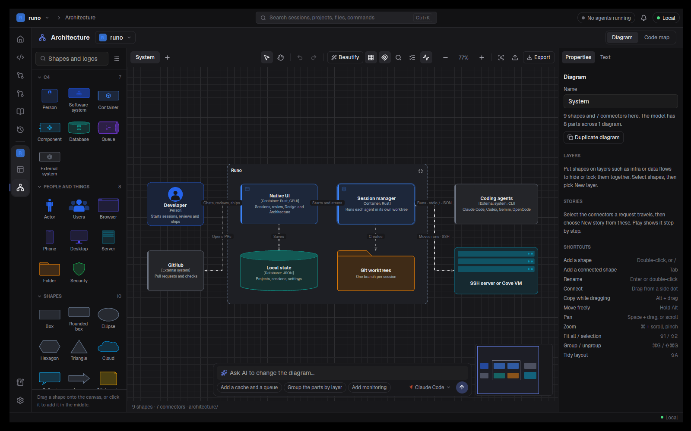
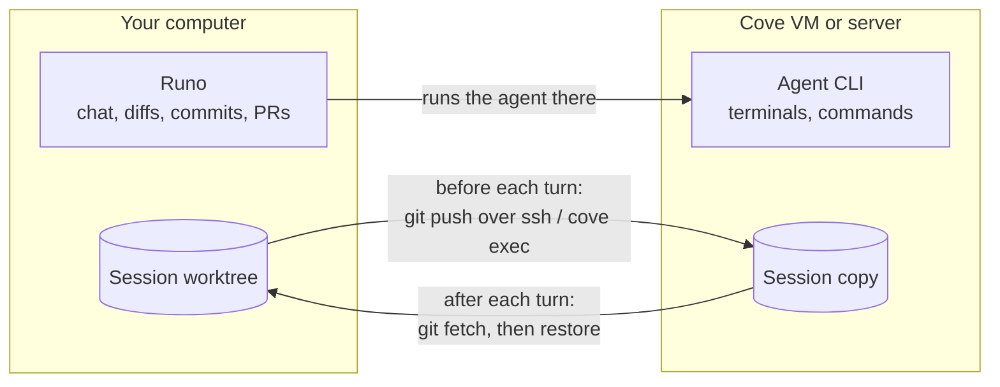

<div align="center">


<h1>Runo</h1>

<h3>Ten agents. One crew. Every turn proven.</h3>

<p>
<b>Crew</b> splits your goal into threads, and Claude Code, Codex, Gemini and seven more race it side by side, each in its own git worktree.<br />
Your own tests prove every turn, and the <b>Git place</b>, <b>Design</b> canvas, <b>Architecture</b> diagrams and <b>Cove VMs</b><br />
take it all the way to ship, without leaving one native app.
</p>

<p>
<a href="https://github.com/deltalark/runo/releases/latest"></a>
<a href="https://github.com/deltalark/runo/releases/latest"></a>
<a href="https://github.com/deltalark/runo/releases/latest"></a>
&nbsp;
<a href="#run-from-source"></a>
&nbsp;
<a href="docs/guide"></a>
</p>

<p>
<a href="https://github.com/deltalark/runo/actions/workflows/ci.yml"></a>
<a href="https://github.com/deltalark/runo/releases"></a>
<a href="LICENSE"></a>


</p>

<p>
<a href="#why-runo"><b>Why Runo</b></a> ·
<a href="#whats-new"><b>What's new</b></a> ·
<a href="#crew-one-chat-that-runs-the-work"><b>Crew</b></a> ·
<a href="#features"><b>Features</b></a> ·
<a href="#the-git-place"><b>Git</b></a> ·
<a href="#design-and-architecture"><b>Design</b></a> ·
<a href="#supported-agents"><b>Agents</b></a> ·
<a href="#getting-started"><b>Get started</b></a> ·
<a href="#connections-run-anywhere"><b>Run anywhere</b></a> ·
<a href="#contributing"><b>Contribute</b></a>
</p>

<br />



</div>

<br />

## Why Runo

Coding agents are good at working on their own, but juggling several of them across terminal tabs gets messy fast, and reading every diff to find out whether the work is any good doesn't scale. Runo gives each agent its own session and its own isolated copy of the code, lets **Crew** hand out the work and keep track of it, checks what every turn did, and puts everything you need to steer, review and ship in one place.

<table>
<tr>
<td width="33%" valign="top">

### ⚡ Native and fast
Pure Rust, with no Electron and no web view behind the interface, on macOS, Linux and Windows. It starts instantly and stays light while many agents run.

</td>
<td width="33%" valign="top">

### 🔑 Bring your own agents
Runo drives the agent CLIs you already have installed and signed in. It never sells or proxies tokens.

</td>
<td width="33%" valign="top">

### 🌿 Agents never collide
Every session can get its own git worktree and branch, so parallel agents never overwrite each other's work.

</td>
</tr>
<tr>
<td width="50%" valign="top">

### ✅ Proven, not promised
Your tests, lint and build run after every turn. Red goes back to the agent, and another vendor's agent can give a second opinion.

</td>
<td width="50%" valign="top">

### 🛰️ Run anywhere
Start on your laptop, send the session to a VM or a build server to keep going while you sleep, and pull it back.

</td>
</tr>
<tr>
<td width="33%" valign="top">

### 🎨 Design and diagram
A Figma-style canvas of real HTML screens and a draw.io-style architecture editor, both with AI built in.

</td>
<td width="33%" valign="top">

### 🧩 Nothing hard-coded
Models, effort levels and permission modes are read from each installed CLI, so new releases show up without a Runo update.

</td>
<td width="33%" valign="top">

### ✋ Always in control
Approve permissions, plans and questions from any session or your phone, undo any turn or git step, and cap spending, turns and tokens.

</td>
</tr>
</table>

## What's new

> [!TIP]
> **Runo 0.2.0** is out, and it now runs on **Linux and Windows** as well as macOS. It also brings **Crew**, the **Git place** and **Proof of done**. See the [changelog](CHANGELOG.md) for everything else.

<table>
<tr>
<td width="55%" valign="top">

### ✨ In 0.2.0

- **🐧 Linux and 🪟 Windows builds.** A `.deb` and a tarball for x86_64 and arm64 Linux, and `Runo.exe` for 64-bit Windows, beside the Mac app.
- **🧭 Crew.** One chat per project that answers you and starts threads for the work, each in its own worktree, reporting back with a checklist.
- **🌳 The Git place.** Sync, commit line by line, a history graph with a time machine, branches, clash radar and Undo for every step.
- **✅ Proof of done.** Your tests, lint and build run after every turn. Failures go back to the agent, and another vendor's agent can give a second opinion.
- **🎛️ Settings as a Control Center**, a Tokyo Night dark theme, glass on every page, turn and token limits, and Cove servers set up over SSH in a few clicks.

</td>
<td width="45%" valign="top">



</td>
</tr>
</table>

## Crew: one chat that runs the work

Each project works one of two ways. In **Direct** you start and run sessions yourself. In **Crew** you talk to one chat for the project, and Crew answers what it can and starts **threads** for the rest. Pick the way when you add a project, or switch any time from the project menu.

- **Threads are real sessions.** Each one gets Crew's brief, its own worktree and branch, and the agent you choose. It keeps a checklist and reports back, so Crew's chat shows one live card per thread with what it changed (`PR #148`, `+2 −1` or *No changes*).
- **You stay in charge.** When a thread needs a decision it shows in the corner, in the Inbox and on Home, with the answers as chips. Crew starts at most three threads at once, and it only reads the project; it never changes code itself.
- **Talk to any thread.** The chip over the composer sends a message to Crew (**Auto**), gets just an answer, or starts a **New thread** straight away. Type `@` and a thread's name to message that thread directly.
- **Home starts it all.** "What should Crew take on?" sends your goal to Crew, and Home lists what Crew said last, the decisions waiting on you and every thread.

## Features

### Sessions and worktrees


- **Projects and sessions.** Add any local folder, or clone one from a URL, and start sessions on it. The sidebar groups sessions under each project, on a rail in the project's color, with live status dots, unread markers and `+/-` line counts. Group them by status instead when you'd rather see what needs you.
- **Isolated worktrees.** A session can run in its own branch and folder under `.runo-worktrees/`, branched from the base you pick and named after the task (such as `runo/fix-login-redirect`), or right in your checkout. A setup command runs in each new worktree before the agent starts, and git-ignored files listed in `.worktreeinclude` (such as `.env`) are copied in. **Clean up** in Settings finds worktrees and branches no session uses any more.
- **Race several agents.** Send one task to several agents at once, each in its own worktree, compare the results and keep the best one.
- **Home, Inbox and tabs.** Home is one prompt to start work from that also searches sessions, projects, playbooks and past conversations as you type, with what's waiting and the sessions to pick up again. The Inbox lists every agent waiting on a permission, plan or question with the answers inline, and open sessions stay in tabs you can drag into order.
- **A tidy rail.** Home, Sessions and Git sit on the rail, with the current project's Design and Architecture under its badge. Playbooks, History and Notes live in the ⋯ menu; pin any of them back in **Settings → General → Rail**.
- **Find anything.** The Sessions page searches titles, branches, projects and past conversations, with filters for project, agent and status. **History** lists past Claude Code and Codex conversations on this machine, and opening one resumes that exact conversation.

### Talking to agents

- **Live, structured output.** Each tool step (read, edit, run, search) streams in as it happens and folds into a tidy "Worked · N steps" summary.
- **A composer that knows the CLI.** Mention files with `@`, attach images, and pick model, effort, permission mode and more from options detected from the agent itself. The `/` menu lists the agent's own commands, custom commands, skills and your playbooks. Type your next message while the agent works and it is queued.
- **Approve from anywhere.** Permission requests, questions and plans from any session pop up in the corner, so you can answer without leaving what you're doing. Claude Code's permission requests arrive while the turn runs and it carries on as soon as you answer.
- **Undo, Keep or Review each turn.** Runo checkpoints the worktree before every turn, so you can roll back a turn that went wrong with one click.
- **Context control.** `/compact` shrinks a long conversation and `/clear` starts fresh. Fork a session from any turn with the files as they were then, or edit and resend a sent message.
- **Usage and limits.** Tokens, cost and context per turn and per session, with Claude Code's and Codex's plan usage in the status bar. In **Settings → Safety**, stop an agent that goes quiet, cap spending, turns and tokens per session and per day, and cap how many agents run at once.
- **Fixes, not error messages.** A turn that fails because the agent is signed out, the model isn't available or the CLI is too old offers the fix right under it: sign in, retry with a model that works, or update the CLI.

<table>
<tr>
<td width="55%" valign="top">

### Switch agents mid-task

Hand a session to another agent at any point. Before anything happens, Runo shows exactly what carries over, what starts fresh and roughly what it costs. The outgoing agent writes a short recap, and the new agent picks up in the same folder and branch, with the same changed files. Switching back is free.

</td>
<td width="45%" valign="top">


</td>
</tr>
<tr>
<td width="55%" valign="top">


</td>
<td width="45%" valign="top">

### Chat or the agent's own CLI

Every session has two views of the same conversation. **Chat** is Runo's own interface, and **CLI** runs the agent's real interactive CLI on the same conversation id. Switch between them freely; nothing is resent to the model.

</td>
</tr>
</table>

### Review and ship

- **Proof of done.** Each project lists its checks (tests, lint, typecheck, build), suggested from its `package.json`, `Cargo.toml`, `go.mod`, `pyproject.toml` or `Makefile`. They run after every turn that changes files, and a card under the reply shows the verdict. **Fix it** sends failures back to the agent, or Runo does it on its own for up to 5 rounds, and **Second opinion** has another vendor's agent review the diff read-only, leaving diff notes.
- **Changes.** Real `git` status and diffs for each session, with stage, discard, commit, push and **Create PR** buttons. **Review and ship** takes a finished session's work into the Git place to commit, push and open a pull request. **Merge PR** uses a method the repository allows (merge, squash or rebase), and turns on auto-merge while checks are still running.
- **Diff notes.** Click any diff line, leave a note, and send all notes back to the agent as one follow-up.
- **Files.** Browse and edit the worktree, with syntax highlighting, rendered Markdown, images and CSV tables.
- **Terminal.** A real interactive shell (PTY) in the session's folder, with several tabs per session, your saved commands as one-click buttons, and the agent's own command output.
- **Browser.** A live, interactive page from a Chromium-based browser on your computer (your default one when it's Chromium-based, or the one you pick in Settings), opened in its own tab. Before a page is open it lists the dev servers running on your machine, and for a session on a connection the ones running there, which it forwards to your machine when you open them.

## The Git place

**Git** on the rail (<kbd>⌘</kbd> <kbd>3</kbd>) works on the project folder itself, in four tabs, and says what every step did in plain words. A sync, switch, merge or go back can be taken back with **Undo** for a while afterwards.

- **Changes.** Every session with work waiting, one at a time, beside your folder's own changes. Tick what to commit file by file or line by line; a line you leave out stays in your folder for later.
- **History.** The commits as a graph. Pick one to ask the agent what it did, go back to it, branch from it, undo it, copy it to another branch or mark it as a release. The **time machine** lists every step the folder took and every snapshot taken before an agent's turn, by day, so you can go back to any moment.
- **Branches.** Switch, rename, merge, send or delete branches, and bring back work you set aside. **Clash radar** test-merges every session's work, your folder and the main branch in memory and lists the pairs that change the same lines, long before anyone merges. **Make it reviewable** has an agent write a reviewer's guide, or split a big branch into a stack of small pull requests.
- **Clashes.** When a sync or merge stops on clashes, keep yours, theirs or both at each spot, or let an agent write a version that keeps both sides' intent. Calling it off puts everything back.
- **Seatbelt.** Before anything is pushed, Runo looks for passwords, tokens, key files, `.env` files and leftover clash markers and asks first; while you commit it points out huge files and debugging leftovers.
- **GitHub** (<kbd>⌘</kbd> <kbd>4</kbd>). Pull requests, issues and Actions runs for the project through the `gh` CLI, with one-click "review this PR" sessions whose review you confirm and post, line comments included.

## Design and Architecture

Two canvases for the current project, each with an **Ask AI** bar that hands the change to an agent, shows its work live and keeps the conversation going. A new project can start from either one, before any code exists.

<table>
<tr>
<td width="50%"></td>
<td width="50%"></td>
</tr>
<tr>
<td width="50%"></td>
<td width="50%"></td>
</tr>
</table>

### 🎨 Design: a real design tool, on real HTML

Every screen is a file in `design/screens/`, drawn side by side on a canvas you pan and zoom, so what you design is already code.

- **Edit like in Figma.** Frames, shapes, the pen tool, text and pictures; layers you can name, lock and find; multi-select, copy and paste, groups and auto layout; drag to move and resize with measurements; floating, sticky and pinned layers, gradients, blur and boolean shapes.
- **A design system that scales.** Components with variant properties, instances and an Assets panel; reusable styles; variables with light and dark values; a theme for colour, font, radius and density; shared libraries across projects; design rules in `docs/design.md` that every AI change follows.
- **Prototype and present.** Link screens and press **Play** for a clickable prototype that moves the way iOS, Android or desktop apps do, with smart animate and working switches, tabs and toggles. **Present** it and collect comments with @mentions.
- **AI that edits like you do.** Ask for new screens, variants or changes from pictures, sketches or a sentence. The agent works through Design's own actions on one undo history, shows its changes as they happen, and an undone step can become a design rule.
- **Checks and hand-off.** **Checks** flags low contrast, tiny text, small tap targets, missing alt text and off-theme colours, with **Fix with AI**. Export PNG, JPG or HTML, read any screen as CSS, React or SwiftUI, hand off a spec with tokens, map components to the app's code, and step through version history.

### 🗺️ Architecture: diagrams that know your code

- **A draw.io-style editor** with C4, flowchart and infrastructure shapes, people and devices drawn as what they are, thousands of brand and technology logos, connectors that route around boxes, layers, collapsible boundaries, a minimap and find.
- **From the code.** The **Code map** drafts a diagram from the project's packages, imports and files. Every diagram is a view of one model, saved as TOML in `architecture/` and editable as text beside the canvas.
- **Beautify** untangles a diagram in one click, trying several layouts and keeping the one with the fewest crossings.
- **Motion and stories.** Connectors flow, carry packets or pulse, and a story plays a request step by step with captions. Export an animated SVG or a story player page.
- **AI in the loop.** Ask for a change and see it as a diff on the canvas, green for new and red for removed, then Accept or Reject. Explain or expand any part, redraw a whiteboard photo, and run checks with **Fix with AI**. Import and export draw.io, Mermaid, SVG and PNG.

## Playbooks and automations


Save a task once and run it in any project: from the Playbooks page, from Quick open, by right-clicking a project, or as a slash command inside the agent. Give a playbook a schedule (a time of day, chosen weekdays or a cron expression) and Runo runs it, even while it's closed. Templates cover finding bugs, scanning for vulnerabilities, updating docs, adding tests, reviewing changes and upgrading dependencies.

<details>
<summary><b>Sharing, inputs, permissions and schedules</b></summary>
<br />

- **Share playbooks as files.** A playbook is a `.playbook.md` file: a short header (name, author, version, agent, permissions, inputs) and the instructions. Export one, copy it into a chat, or keep a folder of them in a git repo.
- **Install from anywhere.** Paste a GitHub repo, a link to one file, a local folder or the clipboard into **Install**. Runo lists what it found, marks new and updated playbooks, and shows what each one asks permission to do before you install it. **Update** checks the source again later.
- **Inputs.** Write `{{area}}` in the instructions and Runo asks for it before the run, with a default for scheduled runs.
- **Permissions.** A playbook says whether it may edit files, run commands or use the network, and Runo holds every turn of its session to that in the way each agent allows: plan mode for read-only, turning off shell or web tools, Codex's sandbox without network. Where an agent can't be held to a limit, the card and the run form say so. Approving a read-only playbook's plan asks before allowing edits.
- **Schedules.** Scheduled runs use the project's default connection and its setup command, skip a run while the last one is still going, note runs missed while Runo was closed, and keep the last few sessions (set in Settings → Agents → Chat). Each card shows its recent runs and any failure. Turn on **Run while Runo is closed** to have a background job (launchd on macOS, a systemd user timer on Linux, Task Scheduler on Windows) run due playbooks every 5 minutes while Runo isn't open.
- **Agents can start playbooks**, and Runo asks you first (on by default). An agent in plan mode can't start one that edits or runs commands.

</details>

## Memory and MCP

- **Project notes.** Keep each project's commands, decisions and gotchas in Markdown, saved as you type, with Write, Split and Preview views, an outline and search across projects. Turn on **Share with agents** and every new session in that project starts with the notes.
- **Session memory.** Runo ships a small MCP server that lets any agent read the session memory, search earlier sessions in the project and save notes, instead of having the whole history pasted into every prompt.
- **Shared MCP servers.** Runo finds the MCP servers configured in every app on your computer, and you can share any of them with all agents, not just the one it was set up for.
- **Runo's own servers.** Add servers to Runo's own list in **Settings → Agents → MCP** and every agent's sessions get them. Cursor, Gemini CLI and Droid read them from their project config file, which Runo fills in for each turn, keeps out of git and tidies afterwards; Grok has no project-level MCP config, so it gets none.
- **Hooks and skills.** See the Claude Code hooks and skills that apply to a project, open them in Runo's editor, and start a new skill.

## Made to feel at home

<table>
<tr>
<td width="50%" valign="top">

### 💬 The Runo assistant
The Runo mark in the corner answers questions about Runo itself. Press <kbd>⌘</kbd> <kbd>J</kbd>, ask how to do something, and it answers from the [built-in guide](docs/guide) with your default agent on a fast model, then offers to take you to the right place. It never changes anything, and **Guide only** answers without an agent at all. Turn it on in **Settings → General**.

</td>
<td width="50%" valign="top">

### 🧰 Agent setup, built in
See which agent CLIs are installed, every copy on your machine and their versions. Install missing ones, sign in right after, test each model, and get a heads-up when an update is out. Runo updates the exact copy it runs, and each agent has its own default model, executable, arguments and environment.

</td>
</tr>
</table>

- **Quick open** with <kbd>⌘</kbd> <kbd>K</kbd> to jump to any session, file, project or command, and <kbd>⌘</kbd> <kbd>N</kbd> for a new session.
- **Your own shortcuts.** In **Settings → Keys**, click a shortcut and press the new keys. Runo warns you when the keys are already taken, and you can reset one or all of them.
- **Light and Tokyo Night dark themes**, accent colors, colorblind-friendly diff colors, and an optional glass look (Subtle, Frosted or Clear) over a blurred desktop.
- **Settings as a Control Center.** Settings opens on an overview with a card per area (look, agents, connections, safety, phone, worktrees and keys) showing what's set and what needs you.
- **It remembers.** Your layout, open tabs and panels come back after a restart, and local agent turns keep running when Runo closes or crashes.
- **A one-minute tour** on first launch that you can replay any time, and **right-click menus** everywhere.

## Supported agents

Runo detects each CLI on your `PATH` and shows its version in **Settings → Agents**.

| Agent | Command | | Agent | Command |
| --- | --- | --- | --- | --- |
| Claude Code | `claude` | | Copilot | `copilot` |
| Codex | `codex` | | Amp | `amp` |
| Gemini | `gemini` | | Droid | `droid` |
| OpenCode | `opencode` | | Qwen Code | `qwen` |
| Cursor | `cursor-agent` | | Grok | `grok` |

See [provider setup](docs/providers.md) for details.

## Getting started

### Download

Get the latest build from the [Releases](https://github.com/deltalark/runo/releases/latest) page:

| Platform | Download | Install |
| --- | --- | --- |
| 🍎 **macOS** (Apple silicon and Intel) | `Runo-<version>-macos-arm64.dmg` or `-x86_64.dmg` | Open the disk image and drag Runo to Applications. |
| 🐧 **Linux** (x86_64 and arm64) | `Runo-<version>-linux-<arch>.deb` or `.tar.gz` | `sudo apt install ./Runo-<version>-linux-<arch>.deb`, or unpack the tarball and run `Runo`. |
| 🪟 **Windows** (64-bit) | `Runo-<version>-windows-x86_64.zip` | Unzip and run `Runo.exe`. The build isn't signed yet, so SmartScreen asks the first time (More info → Run anyway). |

Runo checks for newer versions and offers the download for your platform; nothing installs on its own. Shortcuts in this README use <kbd>⌘</kbd>; on Linux and Windows press <kbd>Ctrl</kbd> instead.

### Requirements

- macOS, Linux (X11 or Wayland) or Windows 10 and 11
- `git`
- At least one agent CLI from the table above, installed and signed in
- Optional: the [GitHub CLI](https://cli.github.com) (`gh`) for pull requests, issues and Actions, and Chrome, Edge, Brave, Arc or another Chromium-based browser for the Browser tab (on Linux and Windows the Design canvas draws its screens with it too)
- Optional: [Cove](https://github.com/deltalark/cove) for VMs, on a Mac or on your own server
- To build from source: a recent stable [Rust toolchain](https://rustup.rs)

### Run from source

```bash
git clone https://github.com/deltalark/runo
cd runo
cargo run -p runo --release
```

### Build the app

To build `Runo.app` and a disk image with its icon, use [cargo-bundle](https://github.com/burtonageo/cargo-bundle):

```bash
cargo install cargo-bundle
cd native/runo-app && cargo bundle --release
```

On Linux the same command makes a `.deb`, and on Windows the icon is built into `Runo.exe`. To publish a release, see [docs/releasing.md](docs/releasing.md). To change the icon, edit `native/runo-app/assets/icon/runo.svg` and run `python3 build.py` in that folder.

### Where Runo keeps its data

Projects are stored in `~/.runo/state.json` (`%USERPROFILE%\.runo` on Windows), each session in its own file under `~/.runo/sessions`, and settings in `~/.runo/settings.json`. A log for each launch and any crash reports are in `~/.runo/logs`; after a crash, Runo offers to show or report it on the next start. Set `RUNO_HOME` to move them all.

## Connections: run anywhere


A **connection** is a place a session can run besides your own machine. Add them in **Settings → Connections**, pick one under **Runs on** when you start a session (or make it a project's default), and move a session from its header whenever you like.

| Connection | What it is | Where the files are |
| --- | --- | --- |
| 💻 **This machine** | The agent runs directly on your computer. | Your worktree. |
| 📦 **Cove on this machine** | Each session gets its own Linux VM from [Cove](https://github.com/deltalark/cove), on a Mac. | Shared into the VM at the same path, so moving is instant. |
| ☁️ **Cove server** | Cove on your VPS or a big box, set up from Runo over SSH. | A copy on the server, synced every turn. |
| 🔐 **SSH server** | Any Linux or macOS machine you can `ssh` into. | A copy under `~/runo-work`, synced every turn. |

### How moving works



- **Everything travels.** Before each agent turn Runo commits the whole working tree, uncommitted and untracked files included, to a hidden ref and sends it over the connection itself. After the turn it brings the result back the same way. Commits the agent made come back on the branch; everything else comes back uncommitted, exactly as it was left.
- **The conversation travels too.** Claude Code's conversation files go along everywhere, and Codex's to SSH and Cove servers, so after a move the agent resumes the same conversation instead of starting over. Other agents get Runo's handoff brief.
- **Nobody's work is lost.** If files changed on both sides, your machine's version wins and the other is saved under `refs/runo/s<id>/kept-…`. A warning card in the chat says so, with **Restore kept changes**; what you had is saved first, so restoring can be undone too.

<details>
<summary><b>What can't move, terminals, GitHub access and backups</b></summary>
<br />

- **What can't move.** A session whose agent can't take its conversation along starts there with Runo's handoff brief. Folders that aren't git repositories can only run on this machine or Cove on this machine.
- **Terminals open there.** A terminal tab in a remote session is a shell in the session's copy on that machine, synced before it opens and after it closes. The CLI view and the worktree setup command run there the same way, with the agent's conversation carried along, and the Browser tab forwards that machine's dev servers to yours (an SSH tunnel, or through `cove exec` for Cove).
- **No GitHub access needed.** Syncing goes over `ssh` or `cove exec`, never through GitHub, so a VM never needs your credentials. Your machine keeps doing the commits, pushes and pull requests. Turn on **GitHub access** for a connection only if the agent there needs `gh` for its own work; the token is passed per command and never written to disk.
- **Backups (off by default).** Turn them on in Settings and after each turn the checkpoint is also pushed to your project's `origin` as `refs/runo/sessions/<id>`, which no branch list shows. Untracked files stay out unless you ask for them, public repositories are never backed up, and the ref is deleted with the session.

</details>

### Close your laptop, the agent keeps going

On a Cove server or an SSH server, the agent runs **detached** from your computer: as a Cove named process, or under `setsid nohup` over SSH. Its output goes to a log on that machine, and Runo follows the log. So you can send a long task, close the lid or shut down, and come back later.

<details>
<summary><b>What happens while you're away</b></summary>
<br />

- **While you're away** the agent keeps working there, and its files stay in the session's copy on that machine.
- **When Runo opens again** it picks the turn back up. The reply replays from the start, and if the turn already finished, its work and conversation come back right away. If it's still running, you watch the rest live.
- **Dropped connections** are handled the same way: Runo reconnects and carries on from the last line it showed, while the agent keeps going.
- **Stop** still stops it: Runo ends the agent's processes there, then brings back what it did so far.
- **Your keys** reach that machine in a script only its owner can read, and the script deletes itself as soon as it starts.
- **Approvals.** Claude Code asks for permission mid-turn through Runo's MCP relay, and the turn waits while you answer in the corner card or the Inbox: **Allow once**, **Always allow** or **Deny**. While Runo is closed or this machine is asleep, the request waits on the server until Runo reconnects and shows it, or until the wait in Settings → Agents → Chat runs out (5 minutes by default). Unanswered, the turn stops at that command and the permission card offers to allow it and retry; turn that off in Settings → Connections to let the agent carry on without it.
- **A turn that never starts**, because the machine rebooted before it ran, ends after a few minutes with a message instead of waiting forever.

Runo also stops keeping your computer awake while only remote turns are running. Cove on this machine runs alongside your computer, so it pauses when the computer does; use a Cove server or an SSH server for work that should go on without it.

</details>

### Agents can use connections too


Runo's MCP server works in every session, in Cove VMs and on servers too: the agent there talks to a small relay script, and Runo answers it over the connection, so nothing listens on a port. Through it, agents get `list_connections` and `run_on`, so they can run a heavy build, a test matrix or some research on another machine without moving the whole session. With **Let agents use Cove** on, agents on your machine also get Cove's own tools and can make throwaway VMs for untrusted code. Each connection has an **Agents may use it** switch, and only the API keys you list for a connection ever reach it.

<details>
<summary><b>Setting one up</b></summary>
<br />

- **SSH:** add an SSH server and type a host from your `~/.ssh/config` (or `user@host`). Runo uses your SSH agent and config, shares one login between the agent, terminals and syncs, and never turns off host key checks. **Test** shows what it found: the OS, git and the agent CLIs.
- **Cove on this machine:** install Cove (see its [install guide](https://github.com/deltalark/cove#install)) and Runo offers a Cove VM under **Runs on** on its own. Set the VM's CPUs, memory, network (on or off) and idle stop in Settings.
- **Cove on a server:** add a Cove connection with the server's SSH login (`user@host`) and press **Set up**: Runo checks the server, installs or updates Cove, pairs with it and keeps its own SSH tunnel to it. Or install Cove yourself, run `cove pair` there and add the server's URL and pairing code. Sign agents in once per server with **Sign in** next to each agent, and every VM there uses that login.

Agent CLIs are installed on the connection on first use, with npm (into a private Node.js when the machine has none) or the vendor's script, and kept at the version you run here. Signing in:

- **API keys** listed for the connection are forwarded, including ones set only in your shell profile.
- **Codex** and **Claude Code on Linux** keep their login in a file, which Runo copies over. Claude Code on macOS keeps it in the keychain, which can't be copied: run `claude setup-token` and export the token as `CLAUDE_CODE_OAUTH_TOKEN`, or set `ANTHROPIC_API_KEY`.
- **Test** lists each agent with whether it's installed there and how it will sign in, and what to do when it can't. Testing Cove on this machine doesn't start a VM.

Deleting a session deletes its VM or its copies on every connection it ran on, and removing a connection cleans up what Runo left there.

</details>

## On your phone

The phone bridge serves a small, token-protected API that a phone app uses to follow every session and answer it: allow or deny a permission request, approve a plan, answer an agent's questions, send a follow-up or stop a run. Turn it on in **Settings → Connections → Phone**, where each phone gets its own pairing code and can be removed on its own, or run `runo --phone`. It listens on your Tailscale address, or only on this computer without one, unless you choose to open it to your local network. See [docs/phone-bridge.md](docs/phone-bridge.md). The mobile app itself is coming next.

## Learn more

- 📖 **[The guide](docs/guide)**: one short article per feature, the same one the Runo assistant answers from.
- 🔌 **[Provider setup](docs/providers.md)**: installing and signing in to each agent.
- 📱 **[Phone bridge](docs/phone-bridge.md)**: the API and how pairing works.
- 📝 **[Changelog](CHANGELOG.md)**: everything that changed, as it lands.

## Status

Runo is early and moving quickly. Version 0.2.0 is the first release for Linux and Windows, so expect those to be a little rougher than macOS for now. Expect rough edges, and please [open an issue](https://github.com/deltalark/runo/issues) when you hit one.

## Contributing

Contributions are welcome. See [CONTRIBUTING.md](CONTRIBUTING.md) to get set up, and [SECURITY.md](SECURITY.md) to report a vulnerability privately.

## License

[MIT](LICENSE)

<br />

<div align="center">

<br />
<sub>Built in Rust for people who run more than one agent at a time.</sub>
</div>
