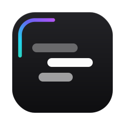
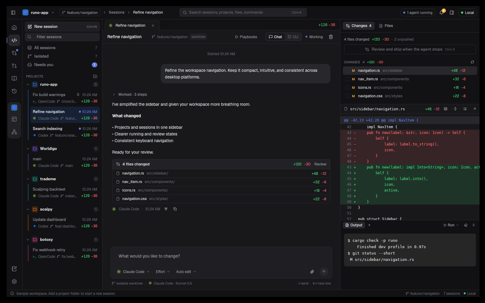
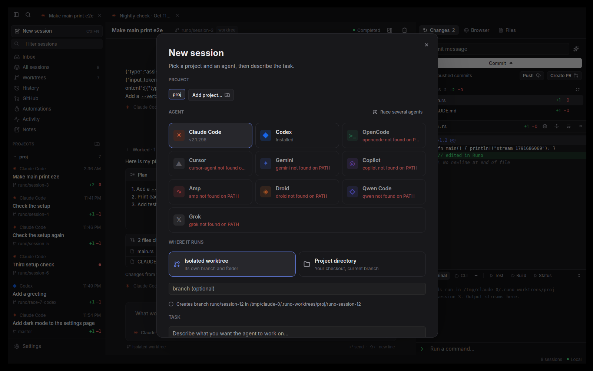
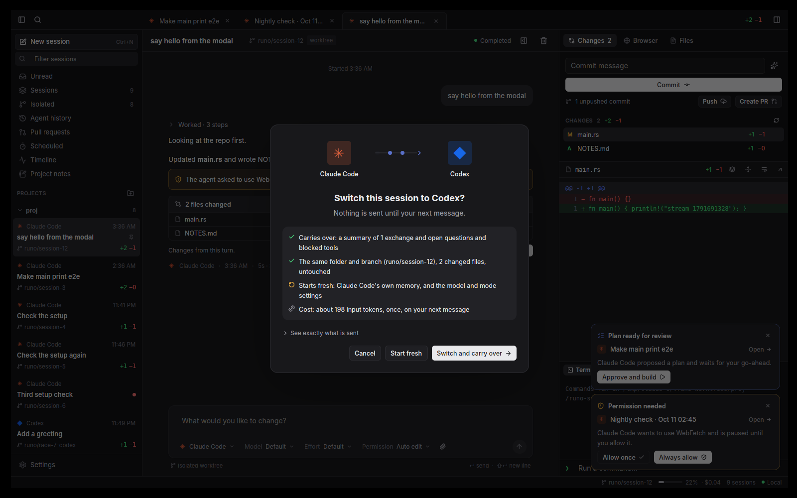
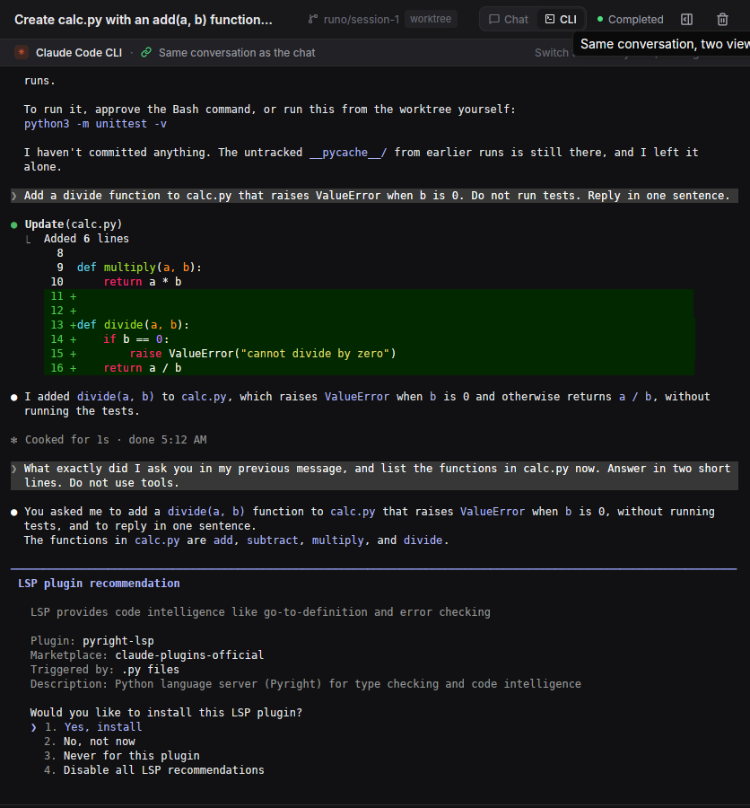
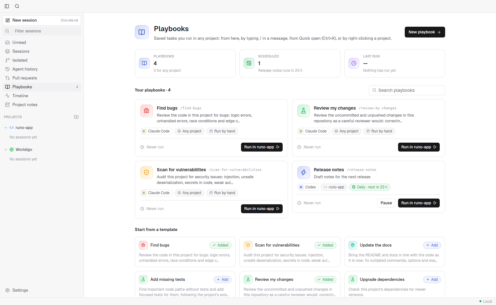
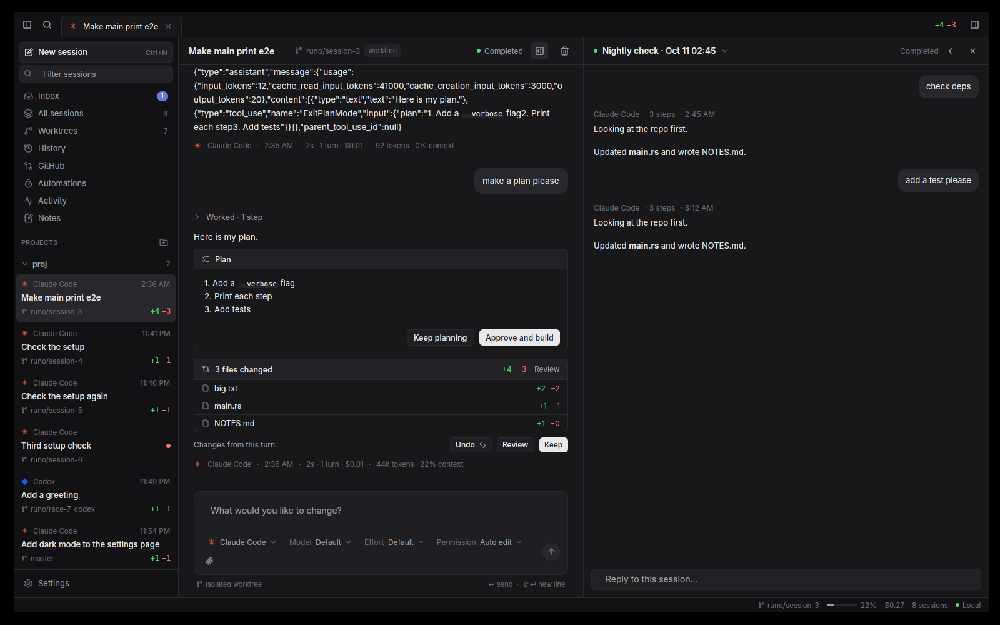
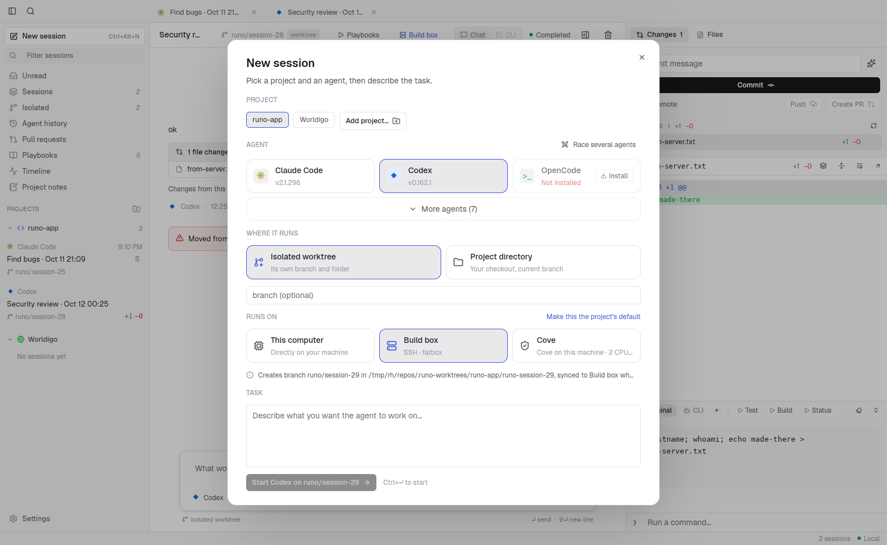
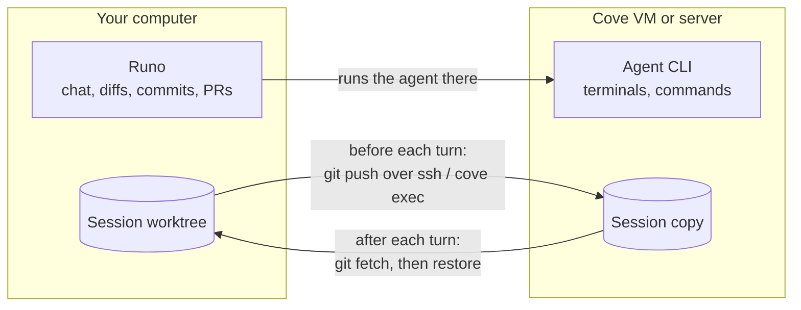
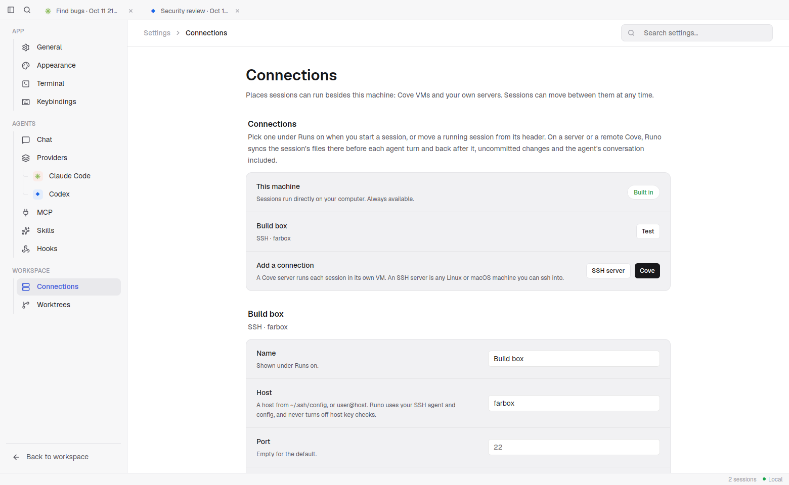

<div align="center">



# Runo

**Run every coding agent side by side, in one native app.**

Claude Code, Codex, Gemini, OpenCode, Cursor and more, each in its own session and its own git worktree,
with live output, diffs, a real terminal, a browser and pull requests in one window.
Run them on your machine, in a Cove VM or on your own server, and move them between the three at any time.

[](LICENSE)


[Features](#features) · [Supported agents](#supported-agents) · [Getting started](#getting-started) · [Connections](#connections-run-anywhere) · [Contributing](#contributing)

<br />



</div>

## Why Runo

Coding agents are good at working on their own, but juggling several of them across terminal tabs gets messy fast. Runo gives each agent its own session and its own isolated copy of the code, then puts everything you need to steer and review them in one place.

- **Native and fast.** Written in pure Rust, with no Electron and no web view behind the interface. It starts instantly and stays light while many agents run.
- **Bring your own agents.** Runo drives the agent CLIs you already have installed and signed in. It never sells or proxies tokens.
- **Nothing hard-coded.** Models, effort levels, permission modes and other options are read from each installed CLI, so new releases show up without a Runo update.
- **Agents never collide.** Every session can get its own git worktree and branch, so parallel agents never overwrite each other's work.
- **Run anywhere, move any time.** Start a session on your laptop, send it to a VM or your build server to keep going while you sleep, and pull it back. The files and the agent's conversation follow it.

## Features

### Sessions and worktrees



- **Projects and sessions.** Add any local folder and start sessions on it. Sessions are grouped by project, with live status dots, unread markers and `+/-` line counts.
- **Isolated worktrees.** A session can run in its own branch and folder under `.runo-worktrees/`, or right in your checkout. A setup command runs in each new worktree, and git-ignored files listed in `.worktreeinclude` (such as `.env`) are copied in.
- **Race several agents.** Send one task to several agents at once, each in its own worktree, compare the results and keep the best one.
- **Tabs and split view.** Open sessions stay in tabs, and any two sessions can sit side by side, each live with its own reply box.
- **Agent history.** Past Claude Code and Codex conversations on this machine are listed, and opening one resumes that exact conversation.

### Talking to agents

- **Live, structured output.** Each tool step (read, edit, run, search) streams in as it happens and folds into a tidy "Worked · N steps" summary.
- **A composer that knows the CLI.** Mention files with `@`, attach images, and pick model, effort, permission mode and more from options detected from the agent itself. Type your next message while the agent works and it is queued.
- **Approve from anywhere.** Permission requests, questions and plans from any session pop up in the corner, so you can answer without leaving what you're doing. Claude Code's permission requests arrive while the turn runs and it carries on as soon as you answer.
- **Undo, Keep or Review each turn.** Runo checkpoints the worktree before every turn, so you can roll back a turn that went wrong with one click.
- **Usage at a glance.** Tokens, cost and context use per turn and per session.

### Switch agents mid-task



Hand a session to another agent at any point. Before anything happens, Runo shows exactly what carries over, what starts fresh and roughly what it costs. The outgoing agent writes a short recap, and the new agent picks up in the same folder and branch, with the same changed files. Switching back is free.

### Chat or the agent's own CLI



Every session has two views of the same conversation. **Chat** is Runo's own interface, and **CLI** runs the agent's real interactive CLI on the same conversation id. Switch between them freely; nothing is resent to the model.

### Review and ship

- **Changes.** Real `git` status and diffs for each session, with stage, discard, commit, push and **Create PR** buttons.
- **Diff notes.** Click any diff line, leave a note, and send all notes back to the agent as one follow-up.
- **Files.** Browse and edit the worktree, with syntax highlighting, rendered Markdown, images and CSV tables.
- **Terminal.** A real interactive shell (PTY) in the session's folder, with several tabs per session, your saved commands as one-click buttons, and the agent's own command output.
- **Browser.** A live, interactive page from a Chromium-based browser already on your Mac, embedded in the session. Before a page is open it lists the dev servers running on your machine.
- **GitHub.** Pull requests, issues and Actions runs for the project through the `gh` CLI, with one-click "review this PR" sessions.

### Playbooks and automations



Save a task once and run it in any project: from the Playbooks page, from Quick open, by right-clicking a project, or as a slash command inside the agent. Give a playbook a schedule and Runo runs it on a timer while it is open. Templates cover finding bugs, scanning for vulnerabilities, updating docs, adding tests, reviewing changes and upgrading dependencies.

- **Share playbooks as files.** A playbook is a `.playbook.md` file: a short header (name, author, version, agent, permissions, inputs) and the instructions. Export one, copy it into a chat, or keep a folder of them in a git repo.
- **Install from anywhere.** Paste a GitHub repo, a link to one file, a local folder or the clipboard into **Install**. Runo lists what it found, marks new and updated playbooks, and shows what each one asks permission to do before you install it. **Update** checks the source again later.
- **Inputs.** Write `{{area}}` in the instructions and Runo asks for it before the run, with a default for scheduled runs.
- **Permissions.** A playbook says whether it may edit files, run commands or use the network, and Runo holds every turn of its session to that in the way each agent allows: plan mode for read-only, turning off shell or web tools, Codex's sandbox without network. Where an agent can't be held to a limit, the card and the run form say so. Approving a read-only playbook's plan asks before allowing edits.
- **Schedules.** Scheduled runs use the project's default connection and its setup command, skip a run while the last one is still going, note runs missed while Runo was closed, and keep the last few sessions (set in Settings → Chat). Each card shows its recent runs and any failure.
- **Agents can start playbooks**, and Runo asks you first (on by default). An agent in plan mode can't start one that edits or runs commands.

### Memory and MCP

- **Project notes and memory.** Runo ships a small MCP server that lets any agent read the session memory, search earlier sessions in the project and save notes, instead of having the whole history pasted into every prompt.
- **Shared MCP servers.** Runo finds the MCP servers configured in every app on your computer, and you can share any of them with all agents, not just the one it was set up for.
- **Runo's own servers.** Add servers to Runo's own list in Settings → MCP and every Claude Code and Codex session gets them.
- **Hooks and skills.** See the Claude Code hooks and skills that apply to a project, open them in Runo's editor, and start a new skill.

### Agent setup, built in

- **Install and update agents from Runo.** See which agent CLIs are installed and their versions, install missing ones (cancel any time; an install stops after 15 minutes), sign in right after, and get a heads-up when an update is out. Runo updates the exact copy it runs and tells you plainly when it shouldn't.
- **Per-agent settings.** Default model, executable path, extra arguments, environment variables and agent-specific options.

### Made to feel at home



- **Quick open** with <kbd>⌘K</kbd> to jump to any session, file or command.
- **Light and dark themes**, accent colors, colorblind-friendly diff colors, and an optional glass look.
- **A one-minute tour** on first launch that you can replay any time.
- **Right-click menus** everywhere: pin, rename, open beside, archive and more.

## Supported agents

Runo detects each CLI on your `PATH` and shows its version in **Settings > Providers**.

| Agent | Command | | Agent | Command |
| --- | --- | --- | --- | --- |
| Claude Code | `claude` | | Copilot | `copilot` |
| Codex | `codex` | | Amp | `amp` |
| Gemini | `gemini` | | Droid | `droid` |
| OpenCode | `opencode` | | Qwen Code | `qwen` |
| Cursor | `cursor-agent` | | Grok | `grok` |

See [provider setup](docs/providers.md) for details.

## Getting started

### Requirements

- macOS (Windows and Linux builds are also targeted, but macOS is the primary platform today)
- A recent stable [Rust toolchain](https://rustup.rs)
- `git`
- At least one agent CLI from the table above, installed and signed in
- Optional: the [GitHub CLI](https://cli.github.com) (`gh`) for pull requests, issues and Actions, and Chrome, Edge, Brave or Chromium for the Browser tab

### Run from source

```bash
git clone https://github.com/deltalark/runo
cd runo
cargo run -p runo --release
```

### Build the app

To build `Runo.app` with its icon, use [cargo-bundle](https://github.com/burtonageo/cargo-bundle):

```bash
cargo install cargo-bundle
cd native/runo-app && cargo bundle --release
```

On Linux the same command makes a `.deb`, and on Windows the icon is built into `Runo.exe`. To change the icon, edit `native/runo-app/assets/icon/runo.svg` and run `python3 build.py` in that folder.

### Where Runo keeps its data

Projects and sessions are stored in `~/.runo/state.json` and settings in `~/.runo/settings.json`. Set `RUNO_HOME` to move them.

## Connections: run anywhere



A **connection** is a place a session can run besides your own machine. Add them in **Settings → Connections**, pick one under **Runs on** when you start a session (or make it a project's default), and move a session from its header whenever you like.

| Connection | What it is | Where the files are |
| --- | --- | --- |
| **This machine** | The agent runs directly on your computer. | Your worktree. |
| **Cove on this machine** | Each session gets its own Linux VM from [Cove](https://github.com/deltalark/cove). | Shared into the VM at the same path, so moving is instant. |
| **Cove server** | Cove on your VPS or a big box, by URL and API key. | A copy on the server, synced every turn. |
| **SSH server** | Any Linux or macOS machine you can `ssh` into. | A copy under `~/runo-work`, synced every turn. |

### How moving works



- **Everything travels.** Before each agent turn Runo commits the whole working tree, uncommitted and untracked files included, to a hidden ref and sends it over the connection itself. After the turn it brings the result back the same way. Commits the agent made come back on the branch; everything else comes back uncommitted, exactly as it was left.
- **The conversation travels too.** Claude Code's conversation files go along everywhere, and Codex's to SSH and Cove servers, so after a move the agent resumes the same conversation instead of starting over. Other agents get Runo's handoff brief.
- **Nobody's work is lost.** If files changed on both sides, your machine's version wins and the other is saved under `refs/runo/s<id>/kept-…`. A warning card in the chat says so, with **Restore kept changes**; what you had is saved first, so restoring can be undone too.
- **What can't move.** A session whose agent can't take its conversation along starts there with Runo's handoff brief. Folders that aren't git repositories can only run on this machine or Cove on this machine.
- **Terminals open there.** A terminal tab in a remote session is a shell in the session's copy on that machine, synced before it opens and after it closes.
- **No GitHub access needed.** Syncing goes over `ssh` or `cove exec`, never through GitHub, so a VM never needs your credentials. Your machine keeps doing the commits, pushes and pull requests. Turn on **GitHub access** for a connection only if the agent there needs `gh` for its own work; the token is passed per command and never written to disk.
- **Backups (off by default).** Turn them on in Settings and after each turn the checkpoint is also pushed to your project's `origin` as `refs/runo/sessions/<id>`, which no branch list shows. Untracked files stay out unless you ask for them, public repositories are never backed up, and the ref is deleted with the session.

### Close your laptop, the agent keeps going

On a Cove server or an SSH server, the agent runs **detached** from your computer: as a Cove named process, or under `setsid nohup` over SSH. Its output goes to a log on that machine, and Runo follows the log. So you can send a long task, close the lid or shut down, and come back later:

- **While you're away** the agent keeps working there, and its files stay in the session's copy on that machine.
- **When Runo opens again** it picks the turn back up. The reply replays from the start, and if the turn already finished, its work and conversation come back right away. If it's still running, you watch the rest live.
- **Dropped connections** are handled the same way: Runo reconnects and carries on from the last line it showed, while the agent keeps going.
- **Stop** still stops it: Runo ends the agent's processes there, then brings back what it did so far.
- **Your keys** reach that machine in a script only its owner can read, and the script deletes itself as soon as it starts.
- **Approvals.** Claude Code asks for permission mid-turn through Runo's MCP relay, and the turn waits while you answer in the corner card or the Inbox: **Allow once**, **Always allow** or **Deny**. While Runo is closed or this machine is asleep, the request waits on the server until Runo reconnects and shows it, or until the wait in Settings → Chat runs out (5 minutes by default). Unanswered, the turn stops at that command and the permission card offers to allow it and retry; turn that off in Settings → Connections to let the agent carry on without it.
- **A turn that never starts**, because the machine rebooted before it ran, ends after a few minutes with a message instead of waiting forever.

Runo also stops keeping your computer awake while only remote turns are running. Cove on this machine runs alongside your computer, so it pauses when the computer does; use a Cove server or an SSH server for work that should go on without it.

### Agents can use connections too



Runo's MCP server works in every session, in Cove VMs and on servers too: the agent there talks to a small relay script, and Runo answers it over the connection, so nothing listens on a port. Through it, agents get `list_connections` and `run_on`, so they can run a heavy build, a test matrix or some research on another machine without moving the whole session. With **Let agents use Cove** on, agents on your machine also get Cove's own tools and can make throwaway VMs for untrusted code. Each connection has an **Agents may use it** switch, and only the API keys you list for a connection ever reach it.

### Setting one up

- **SSH:** add an SSH server and type a host from your `~/.ssh/config` (or `user@host`). Runo uses your SSH agent and config, shares one login between the agent, terminals and syncs, and never turns off host key checks. **Test** shows what it found: the OS, git and the agent CLIs.
- **Cove on this machine:** install Cove (see its [install guide](https://github.com/deltalark/cove#install)) and Runo offers a Cove VM under **Runs on** on its own. Set the VM's CPUs, memory, network (on or off) and idle stop in Settings.
- **Cove on a server:** install Cove on the server, run `cove key` there, then add a Cove connection in Runo with the server's URL and that key.

Agent CLIs are installed on the connection on first use, with npm (into a private Node.js when the machine has none) or the vendor's script, and kept at the version you run here. Signing in:

- **API keys** listed for the connection are forwarded, including ones set only in your shell profile.
- **Codex** and **Claude Code on Linux** keep their login in a file, which Runo copies over. Claude Code on macOS keeps it in the keychain, which can't be copied: run `claude setup-token` and export the token as `CLAUDE_CODE_OAUTH_TOKEN`, or set `ANTHROPIC_API_KEY`.
- **Test** lists each agent with whether it's installed there and how it will sign in, and what to do when it can't. Testing Cove on this machine doesn't start a VM.

Deleting a session deletes its VM or its copies on every connection it ran on, and removing a connection cleans up what Runo left there.

## Status

Runo is early and moving quickly. Expect rough edges, and please [open an issue](https://github.com/deltalark/runo/issues) when you hit one.

## Contributing

Contributions are welcome. See [CONTRIBUTING.md](CONTRIBUTING.md) to get set up, and [SECURITY.md](SECURITY.md) to report a vulnerability privately. Changes are tracked in [CHANGELOG.md](CHANGELOG.md).

## License

[MIT](LICENSE)
