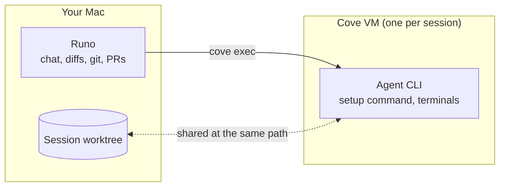

<div align="center">


# Runo

**Run every coding agent side by side, in one native app.**

Claude Code, Codex, Gemini, OpenCode, Cursor and more, each in its own session and its own git worktree,
with live output, diffs, a real terminal, a browser and pull requests in one window.

[](LICENSE)


[Features](#features) · [Supported agents](#supported-agents) · [Getting started](#getting-started) · [Sandboxed sessions with Cove](#sandboxed-sessions-with-cove) · [Contributing](#contributing)

<br />


</div>

## Why Runo

Coding agents are good at working on their own, but juggling several of them across terminal tabs gets messy fast. Runo gives each agent its own session and its own isolated copy of the code, then puts everything you need to steer and review them in one place.

- **Native and fast.** Written in pure Rust, with no Electron and no web view behind the interface. It starts instantly and stays light while many agents run.
- **Bring your own agents.** Runo drives the agent CLIs you already have installed and signed in. It never sells or proxies tokens.
- **Nothing hard-coded.** Models, effort levels, permission modes and other options are read from each installed CLI, so new releases show up without a Runo update.
- **Agents never collide.** Every session can get its own git worktree and branch, so parallel agents never overwrite each other's work.

## Features

### Sessions and worktrees


- **Projects and sessions.** Add any local folder and start sessions on it. Sessions are grouped by project, with live status dots, unread markers and `+/-` line counts.
- **Isolated worktrees.** A session can run in its own branch and folder under `.runo-worktrees/`, or right in your checkout. A setup command runs in each new worktree, and git-ignored files listed in `.worktreeinclude` (such as `.env`) are copied in.
- **Race several agents.** Send one task to several agents at once, each in its own worktree, compare the results and keep the best one.
- **Tabs and split view.** Open sessions stay in tabs, and any two sessions can sit side by side, each live with its own reply box.
- **Agent history.** Past Claude Code and Codex conversations on this machine are listed, and opening one resumes that exact conversation.

### Talking to agents

- **Live, structured output.** Each tool step (read, edit, run, search) streams in as it happens and folds into a tidy "Worked · N steps" summary.
- **A composer that knows the CLI.** Mention files with `@`, attach images, and pick model, effort, permission mode and more from options detected from the agent itself. Type your next message while the agent works and it is queued.
- **Approve from anywhere.** Permission requests, questions and plans from any session pop up in the corner, so you can answer without leaving what you're doing.
- **Undo, Keep or Review each turn.** Runo checkpoints the worktree before every turn, so you can roll back a turn that went wrong with one click.
- **Usage at a glance.** Tokens, cost and context use per turn and per session.

### Switch agents mid-task


Hand a session to another agent at any point. Before anything happens, Runo shows exactly what carries over, what starts fresh and roughly what it costs. The outgoing agent writes a short recap, and the new agent picks up in the same folder and branch, with the same changed files. Switching back is free.

### Chat or the agent's own CLI


Every session has two views of the same conversation. **Chat** is Runo's own interface, and **CLI** runs the agent's real interactive CLI on the same conversation id. Switch between them freely; nothing is resent to the model.

### Review and ship

- **Changes.** Real `git` status and diffs for each session, with stage, discard, commit, push and **Create PR** buttons.
- **Diff notes.** Click any diff line, leave a note, and send all notes back to the agent as one follow-up.
- **Files.** Browse and edit the worktree, with syntax highlighting, rendered Markdown, images and CSV tables.
- **Terminal.** A real interactive shell (PTY) in the session's folder, with several tabs per session, your saved commands as one-click buttons, and the agent's own command output.
- **Browser.** A live, interactive page from a Chromium-based browser already on your Mac, embedded in the session. Before a page is open it lists the dev servers running on your machine.
- **GitHub.** Pull requests, issues and Actions runs for the project through the `gh` CLI, with one-click "review this PR" sessions.

### Playbooks and automations


Save a task once and run it in any project: from the Playbooks page, from Quick open, by right-clicking a project, or as a slash command inside the agent. Give a playbook a schedule and Runo runs it on a timer while it is open. Templates cover finding bugs, scanning for vulnerabilities, updating docs, adding tests, reviewing changes and upgrading dependencies.

### Memory and MCP

- **Project notes and memory.** Runo ships a small MCP server that lets any agent read the session memory, search earlier sessions in the project and save notes, instead of having the whole history pasted into every prompt.
- **Shared MCP servers.** Runo finds the MCP servers configured in every app on your computer, and you can share any of them with all agents, not just the one it was set up for.
- **Hooks and skills.** See the Claude Code hooks and skills that apply to a project.

### Agent setup, built in

- **Install and update agents from Runo.** See which agent CLIs are installed and their versions, install missing ones, and get a heads-up when an update is out. Runo updates the exact copy it runs and tells you plainly when it shouldn't.
- **Per-agent settings.** Default model, executable path, extra arguments, environment variables and agent-specific options.

### Made to feel at home


- **Quick open** with <kbd>⌘K</kbd> to jump to any session, file or command.
- **Light and dark themes**, accent colors, colorblind-friendly diff colors, and an optional glass look.
- **A one-minute tour** on first launch that you can replay any time.
- **Right-click menus** everywhere: pin, rename, open beside, archive and more.

## Supported agents

Runo detects each CLI on your `PATH` and shows its version in **Settings > Providers**.

| Agent | Command | | Agent | Command |
| --- | --- | --- | --- | --- |
| Claude Code | `claude` | | Copilot | `copilot` |
| Codex | `codex` | | Amp | `amp` |
| Gemini | `gemini` | | Droid | `droid` |
| OpenCode | `opencode` | | Qwen Code | `qwen` |
| Cursor | `cursor-agent` | | Grok | `grok` |

See [provider setup](docs/providers.md) for details.

## Getting started

### Requirements

- macOS (Windows and Linux builds are also targeted, but macOS is the primary platform today)
- A recent stable [Rust toolchain](https://rustup.rs)
- `git`
- At least one agent CLI from the table above, installed and signed in
- Optional: the [GitHub CLI](https://cli.github.com) (`gh`) for pull requests, issues and Actions, and Chrome, Edge, Brave or Chromium for the Browser tab

### Run from source

```bash
git clone https://github.com/deltalark/runo
cd runo
cargo run -p runo --release
```

### Build the app

To build `Runo.app` with its icon, use [cargo-bundle](https://github.com/burtonageo/cargo-bundle):

```bash
cargo install cargo-bundle
cd native/runo-app && cargo bundle --release
```

On Linux the same command makes a `.deb`, and on Windows the icon is built into `Runo.exe`. To change the icon, edit `native/runo-app/assets/icon/runo.svg` and run `python3 build.py` in that folder.

### Where Runo keeps its data

Projects and sessions are stored in `~/.runo/state.json` and settings in `~/.runo/settings.json`. Set `RUNO_HOME` to move them.

## Sandboxed sessions with Cove

[Cove](https://github.com/deltalark/cove) runs fast, persistent Linux microVMs on your Mac. When Cove is installed and `cove serve` is running, **New session** offers **Runs on: Cove VM**, and the session gets its own VM (`runo-<id>`).



- The agent, the worktree setup command and terminal tabs all run inside the VM.
- The session folder is shared into the VM at the same path, so git, diffs, commits and pull requests keep running on your Mac against the same files.
- The VM sees only that folder (and the repository's `.git`, read-only), plus `ANTHROPIC_API_KEY`, `CLAUDE_CODE_OAUTH_TOKEN`, `OPENAI_API_KEY` and `OPENROUTER_API_KEY` when Runo has them. Your home folder, keychain and SSH keys stay out of reach.
- Claude Code, Codex and OpenCode are installed in the VM on first use, and deleting the session deletes its VM.

## Status

Runo is early and moving quickly. Expect rough edges, and please [open an issue](https://github.com/deltalark/runo/issues) when you hit one.

## Contributing

Contributions are welcome. See [CONTRIBUTING.md](CONTRIBUTING.md) to get set up, and [SECURITY.md](SECURITY.md) to report a vulnerability privately. Changes are tracked in [CHANGELOG.md](CHANGELOG.md).

## License

[MIT](LICENSE)
