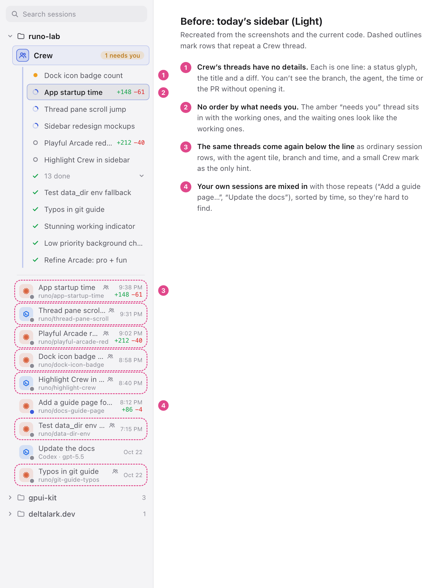
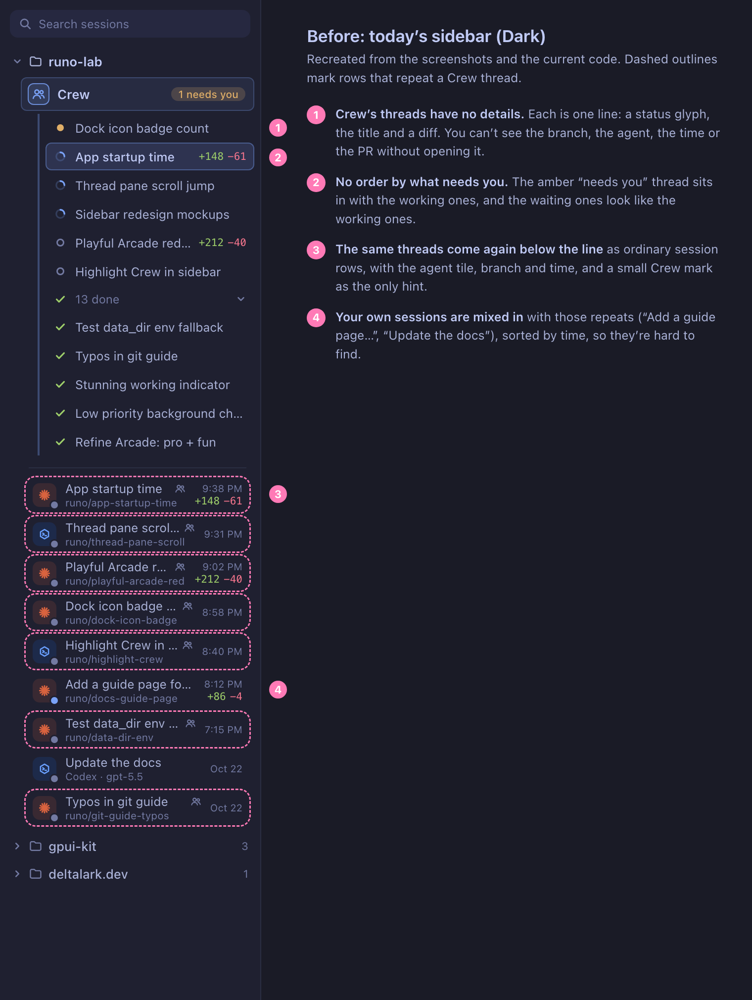
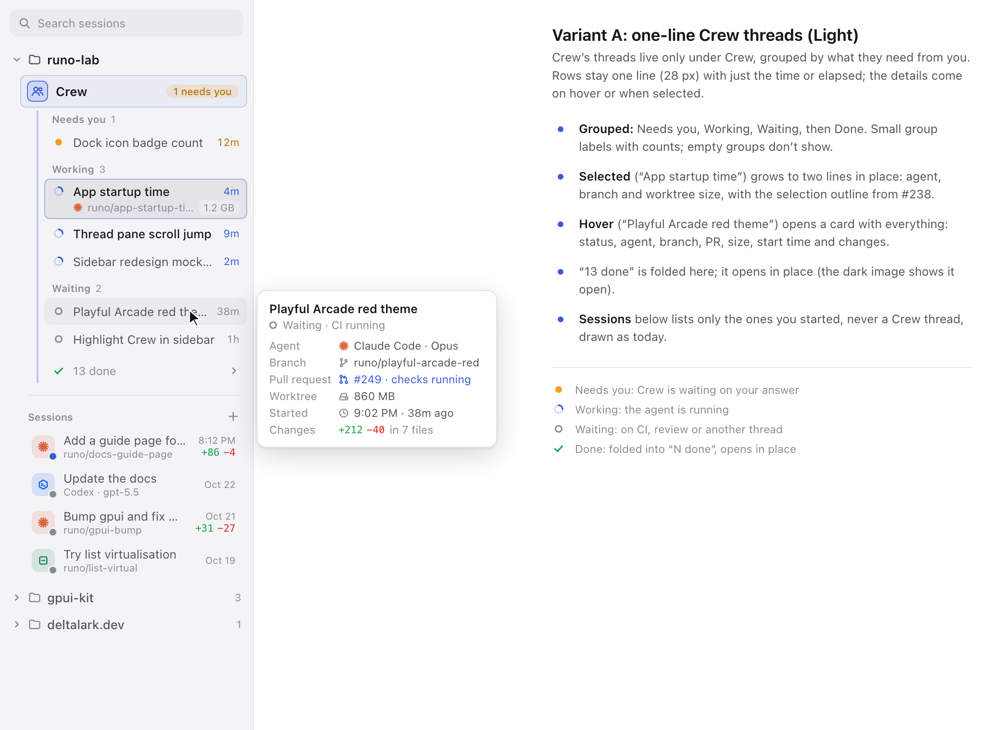
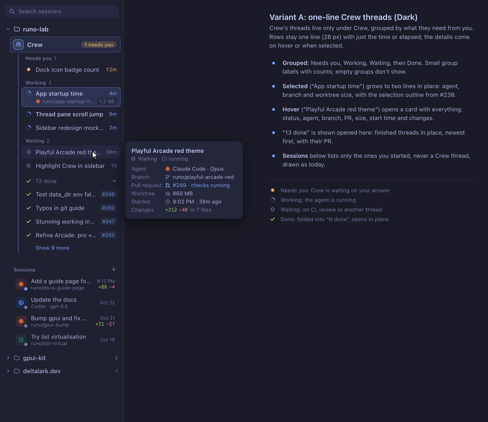
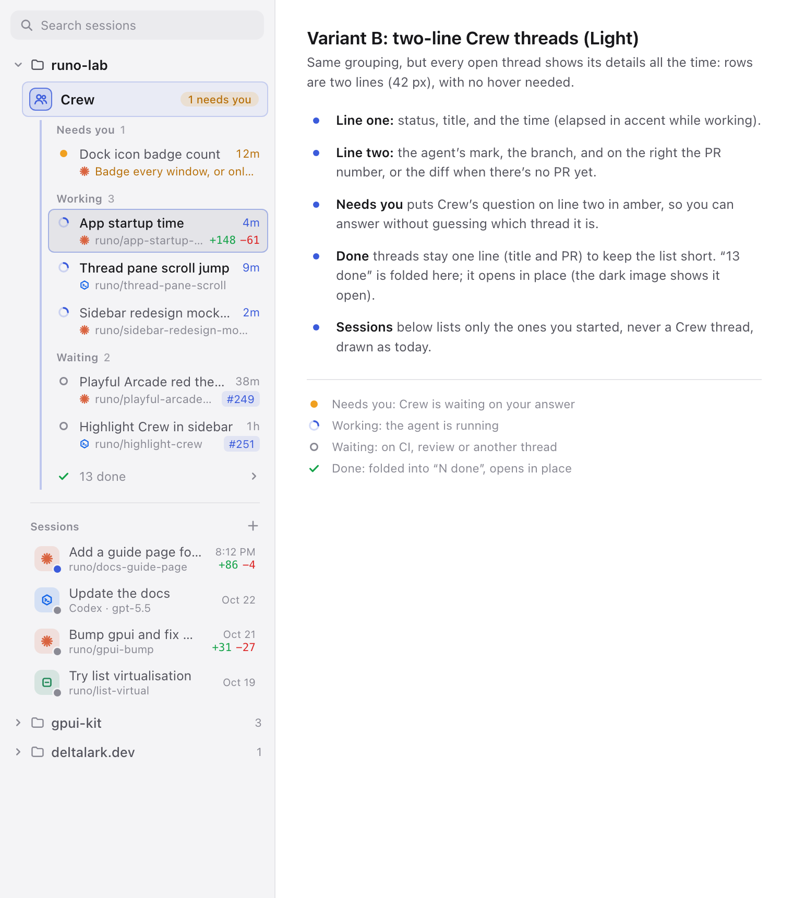
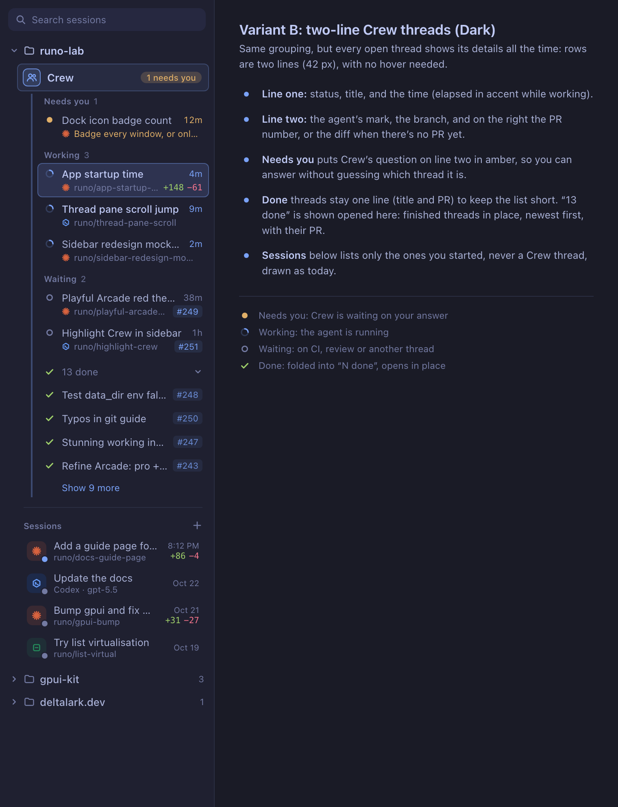

# Sidebar redesign mockups (design only)

Crew's threads shown only under Crew, grouped by what they need from you; the project's
own sessions below under "Sessions", never repeating a Crew thread.

`sidebar.html?v=before|a|b&t=light|dark` draws each mockup with Runo's palettes (runo light,
tokyo-night dark). `./render.sh` renders the PNGs with headless Chrome.

| | Light | Dark |
|---|---|---|
| Before |  |  |
| A: one-line, details on hover/selected |  |  |
| B: two-line, details always |  |  |

The light images show "13 done" folded and the dark images show it open.
