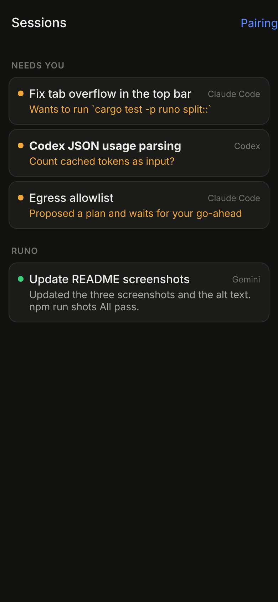
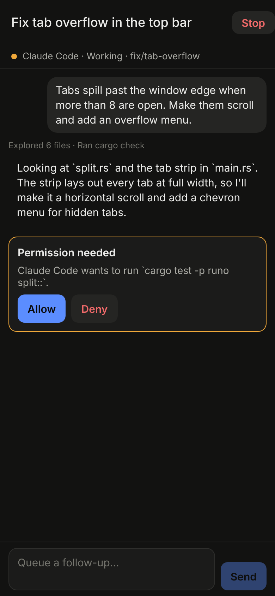
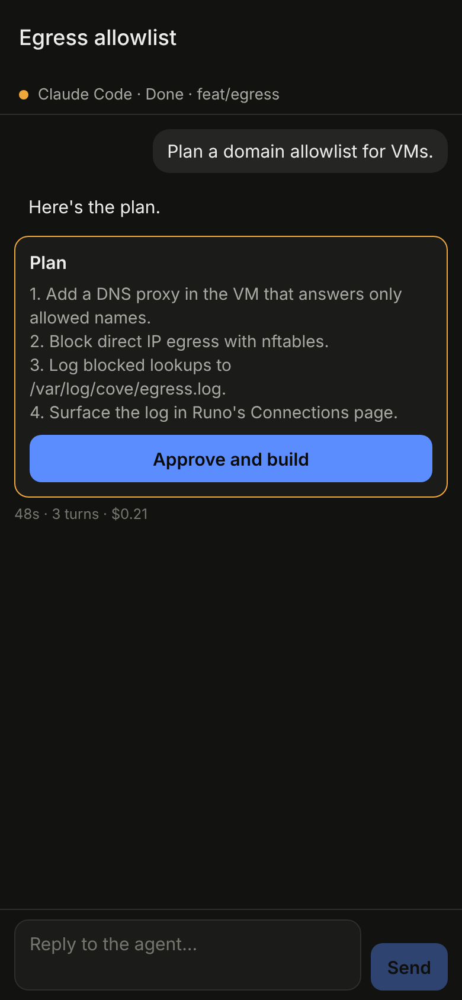
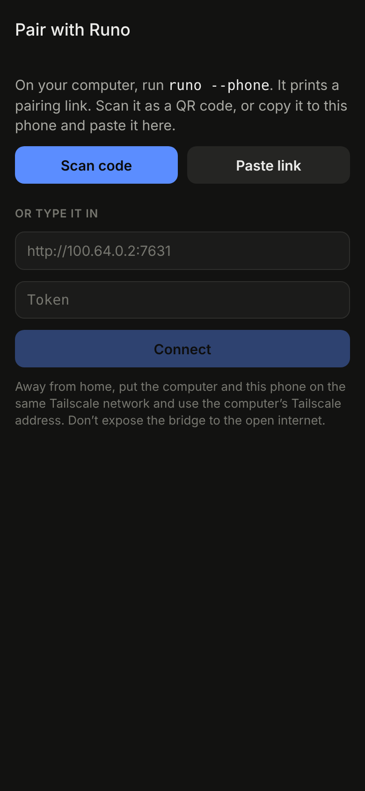

# Runo mobile

Your Runo sessions on your phone: see what every agent is doing, answer permission
requests, approve plans, pick answers to an agent's questions, send follow-ups and stop a
run. Built with React Native and Expo, for iOS and Android.

<p>
  
  
  
  
</p>

## How the phone reaches your sessions

```
phone ──HTTP──▶ runo --phone (on your computer) ──▶ ~/.runo state, approvals
                         │
                         └──▶ ~/.runo/phone-inbox ──▶ the Runo app runs it
```

- `runo --phone` is a small HTTP API served by the Runo binary itself, without a window.
  It reads the same saved state and live approvals the desktop app uses
  (`native/runo-app/src/phone.rs`).
- **Permission requests** are answered by the bridge directly, exactly like the corner
  card, so an agent waiting on one carries on as soon as you tap Allow.
- **Follow-ups, Stop, plan approvals and answers** are left in `~/.runo/phone-inbox`. The
  open Runo app picks them up within a couple of seconds and runs them as if you'd typed
  them, so queues, limits and per-agent settings all still apply. Keep Runo open for these.
- Turns on SSH and Cove connections already keep running with your laptop asleep; the
  phone sees them whenever the computer running the bridge is awake.
- Every request carries a 256-bit token made on first run and kept in
  `~/.runo/phone.json`. The bridge speaks plain HTTP, so use it over your home Wi-Fi or a
  private network such as [Tailscale](https://tailscale.com), never open to the internet.

### API

All paths need `Authorization: Bearer <token>`. `GET`s return an `ETag`; send it back as
`If-None-Match` to get `304` when nothing changed (the app polls every 2 to 3 seconds).

| Method and path | What it does |
| --- | --- |
| `GET /v1/hello` | `{ app, version, api }`, used to check a pairing |
| `GET /v1/sessions` | Projects, and every session with its status, preview and what it needs from you |
| `GET /v1/sessions/:id` | The last 200 messages, queued prompts and pending permission requests |
| `POST /v1/sessions/:id/prompt` | `{ text }`: a follow-up, queued while the agent works |
| `POST /v1/sessions/:id/stop` | Stop the running turn |
| `POST /v1/sessions/:id/plan` | Approve the proposed plan and build it |
| `POST /v1/sessions/:id/allow` | `{ tools }`: allow denied tools once and continue |
| `POST /v1/sessions/:id/answers` | `{ picks }`: one answer (or `null`) per question |
| `POST /v1/approvals/:id` | `{ allow }`: answer a live permission request |

The types the app reads are in [`src/lib/types.ts`](src/lib/types.ts).

## Try it

1. On your computer, from the repo root:

   ```sh
   cargo run -p runo -- --phone            # listens on 0.0.0.0:7631
   cargo run -p runo -- --phone 100.x.y.z:7631   # or only on your Tailscale address
   ```

   It prints a QR code and a `runo://pair?...` link.

2. Start the app:

   ```sh
   cd mobile
   npm install
   npx expo start
   ```

   Open it on your phone with Expo Go (scan the code Expo shows), or make a development
   build with `npx expo run:ios` / `npx expo run:android`.

3. In the app, tap **Scan code** and scan the QR code from step 1, or paste the link.

The bridge is plain HTTP. Development builds allow that through `app.json`
(`NSAllowsArbitraryLoads` on iOS, `usesCleartextTraffic` on Android); Expo Go loads its
own bundles over HTTP and should allow it too.

## Develop

```sh
npm run typecheck
npm test            # pairing links, list grouping, code blocks (node --test)
```

Routes live in `src/app` (Expo Router); everything else is in `src/lib` and
`src/components`. The bridge's tests run with the rest of Runo's: `cargo test -p runo phone::`.

## Next

- Push notifications when a session needs you, so you don't have to keep the app open.
- Turn the bridge on from Settings in the desktop app, with the QR code shown there.
- Serve the same API from a Cove server, so detached runs can be answered with your
  computer off.
- Start new sessions and run playbooks from the phone; see diffs.
